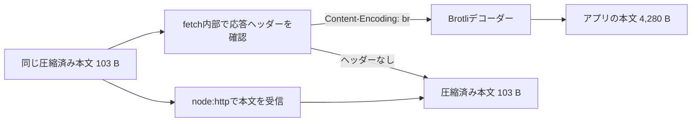
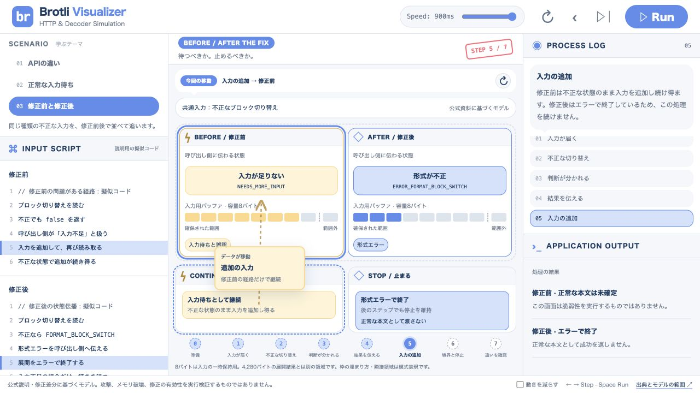

# Brotliを直接使わないコードにも脆弱性対応が必要になる理由

> Node.jsの`fetch()`は、HTTP応答のヘッダーに応じて内部でBrotliを展開します。そのため、自分のコードに展開APIがなくても、受け取ったデータがデコーダーに届く場合があります。CVE-2026-111497では、不正な入力を「続きが必要」と扱う経路があり、内部バッファの境界外への書き込みにつながりました。

- 対象・前提：Web開発者向け。HTTP実験はMacのNode.js v24.22.1。後半の対応体験は別のWindows 11開発機とWSL Ubuntu 24.04の記録。HTTPリクエストとレスポンスの概要を知っていることを想定
- LT資料：[5分で話すSlidev資料・発表者ノート](../talks/brotli/README.md)（この記事の2026-10-28版に基づく）

## 自分ではBrotliを使っていないつもりだった

調べ始めたきっかけは、Brotliの脆弱性対応がいろいろな製品で必要になると知り、「なぜそんなに更新箇所があるのか」と疑問に思ったことでした。

JPCERT/CCの注意喚起によると、今回の問題はGoogle BrotliのC言語実装にあり、Node.js、Bun、Python向けパッケージなどに影響します。「Node2Shell」「HTTP2Shell」は、このCVEに関連する呼び名です。この記事では混同を避けるため、CVE-2026-111497を基準に話を進めます。[S1：JPCERT/CC](https://www.jpcert.or.jp/at/2026/at260034.html)

中心となる問いは、**Brotliを直接呼ぶコードを書いていなくても、なぜこの脆弱性への対応が関係するのか**です。自分で確認した正常なHTTP通信から始め、デコーダーの入力待ち、今回の不具合、更新を届ける先まで順にたどります。

Brotliには、可逆圧縮の形式・方式という意味と、それを実行するライブラリという意味があります。ここで扱う欠陥はC実装の展開処理にあるものです。形式の仕様と、その仕様を実行するプログラムは分けて考えます。[S1](https://www.jpcert.or.jp/at/2026/at260034.html)、[S3：Brotli公式リポジトリ](https://github.com/google/brotli)

## シミュレーターを開いて一緒にたどる

記事に対応する[Brotli Visualizerを開く](../simulators/brotli/dist/index.html)と、同じ画面で3つのモードを試せます。[操作説明](../simulators/brotli/README.md)も用意しました。プロジェクトからシミュレーターだけを起動する場合は、ルートで次を実行します。

```sh
node simulators/brotli/serve.mjs
```

`node`で静的ファイル用のサーバーを起動するコマンドです。`127.0.0.1`は自分のMacを指します。上部の「▷│」で1ステップずつ進み、移動経路の右の「↻」で同じ移動を見直せます。Speedを遅くすると、カードもゆっくり動きます。

| モード | この記事で見ること |
| --- | --- |
| 01 APIの違い | 同じ圧縮済み本文が、fetchとnode:httpで違う結果になる理由 |
| 02 正常な入力待ち | デコーダーが途中で待ち、次の断片で再開する仕組み |
| 03 修正前と修正後 | 形式エラーを入力待ちと取り違えた経路と、その修正 |

**正常系の最終値は実測値、カードの移動・断片A/B/C・待機位置・バッファの塗り分けは説明用のモデルです。** シミュレーターはブラウザー内の状態を切り替えており、脆弱なデコーダーや攻撃データを実行しません。以下では、実測を[E1][E2]、一次資料を[S番号]で示します。

## 同じ103バイトを受け取ったのに結果が違った

### 受信コードに展開APIを書かずに比較する

確かめたかったのは、「HTTPで本文を受け取るだけでも、Brotliの展開処理が呼ばれるのか」です。予想は、`node:http`では圧縮されたまま、`fetch()`では応答の`Content-Encoding: br`に応じて展開される、というものでした。

2026-10-27に、次の環境と条件で比較しました。[E1：検証記録](../notes/brotli-http-auto-decode-2026-10-27.md)

| 項目 | 条件 |
| --- | --- |
| 実行環境 | macOS 15.8.1 / arm64、Node.js v24.22.1 |
| 同梱ライブラリの表示 | Brotli 1.2.0、Undici 7.30.1 |
| 通信 | 127.0.0.1上のHTTP/1.1、GET、正常応答200 |
| 元の本文 | 自作の日本語テキスト1行を40回繰り返したUTF-8の4,280バイト |
| 圧縮 | Brotliのqualityを4に固定。結果は103バイト |
| そろえた条件 | 全リクエストに`Accept-Encoding: br`を明示。サーバーは同じ圧縮済みBufferを返す |

再現コマンドは次のとおりです。

```sh
node experiments/brotli-http/run.mjs
```

[run.mjs](../experiments/brotli-http/run.mjs)は、正常データの圧縮、ローカルサーバー起動、3ケースの通信、バイト列の一致確認、サーバー停止まで行います。ポート番号は空いているものを選ぶので、実行ごとに変わって構いません。

受信側の[client.mjs](../experiments/brotli-http/client.mjs)には、Brotli展開APIの呼び出しがありません。fetch側の要点はこれだけです。

```js
const response = await fetch(url, {
  headers: { 'Accept-Encoding': 'br' },
});
const body = Buffer.from(await response.arrayBuffer());
```

`arrayBuffer()`は本文を最後まで読み出します。`Buffer.from()`は受け取ったバイト列をNode.jsのBufferとして扱うための変換です。Brotliの展開は、この2つを自作の展開処理として使っているのではなく、後述するfetch内部の経路で行われます。

### バイト数だけでなく内容も一致した

保存した[実行ログ](../experiments/brotli-http/result-2026-10-27.txt)は、次の結果になりました。自分のターミナルでの追試でも同じ結果を確認しました。[E1](../notes/brotli-http-auto-decode-2026-10-27.md)

| ケース | 受信API | 応答のContent-Encoding | 送った本文 | アプリが読み出した本文 | バイト列の一致先 |
| --- | --- | --- | ---: | ---: | --- |
| A | node:http | br | 103 B | 103 B | 圧縮済みデータ |
| B | fetch | br | 103 B | 4,280 B | 元の本文 |
| C | fetch | なし | 103 B | 103 B | 圧縮済みデータ |

Cも同じ圧縮済みデータを送っています。圧縮済みファイルのバイト列をそのまま渡す比較条件として、HTTPのContent-Encodingを付けていません。

ログの`Every request ...`は、実験が全リクエストに同じ要求ヘッダーを設定したという案内です。`Server-side observations`は、サーバー側で実際に受け取った要求と、返した応答を記録した表です。受信側の表と合わせることで、「サーバーがfetchにだけ大きな本文を送った」という説明を切り分けられます。

### 2つのヘッダーは役割が違う

| ヘッダー | 今回の向き | 意味 |
| --- | --- | --- |
| `Accept-Encoding: br` | クライアント → サーバー | Brotliで符号化した応答を受け取れる、と伝える |
| `Content-Encoding: br` | サーバー → クライアント | この応答の本文にBrotliの符号化を適用した、と伝える |

これは要求での受け入れ条件と、応答に適用した符号化の違いです。[S13：RFC 9110 §12.5.3](https://www.rfc-editor.org/rfc/rfc9110.html#section-12.5.3)、[§8.4](https://www.rfc-editor.org/rfc/rfc9110.html#section-8.4)

`Accept-Encoding`を指定するだけで、node:httpに自動展開機能が追加されるわけではありません。Aでも同じヘッダーを送りましたが、圧縮済みの103バイトを受け取っています。

fetchのBでは、読み出した本文が4,280バイトでも、アプリに見える`Content-Length`は103のままでした。103は送信された圧縮済み本文の長さ、4,280は展開後にアプリで測った長さなので、矛盾しません。HTTPヘッダーやTCP/IPまで含む総通信量を測った数値でもありません。[E1](../notes/brotli-http-auto-decode-2026-10-27.md)、[S13：RFC 9110 §8.6](https://www.rfc-editor.org/rfc/rfc9110.html#section-8.6)

## fetchの内部にはデコーダーを通る経路がある

**デコーダー**は、符号化されたデータを読み、元のデータへ戻す処理です。ここではBrotliで圧縮したデータを展開する部品を指します。

**パイプライン**は、前の処理が出したデータを次の処理へ渡すようにつないだ経路です。GitHub Actionsで工程をつなぐイメージは入口になりますが、ここで流れているのはHTTP本文のバイト列です。

今回の違いを、処理の役割で描くとこうなります。



図は別々のリクエストの比較です。1本のHTTP応答が物理的に2つへ分裂する図ではありません。また、正常に展開された結果だけを示し、エラー経路は省略しています。

Node.js v24.22.1に同梱されたUndiciのfetch実装では、応答のContent-Encodingが`br`なら`zlib.createBrotliDecompress()`を選び、本文のストリームとデコーダーを`pipeline()`で接続します。デコーダーを選ばない条件では、本文をそのまま渡す経路になります。[S9：同梱Undiciの実装](https://github.com/nodejs/node/blob/v24.22.1/deps/undici/src/lib/web/fetch/index.js#L2256)

さらにNode.jsのネイティブ側では、Brotli展開処理から`BrotliDecoderDecompressStream()`を呼び出しています。「自分の受信コード → fetch内部 → node:zlibの展開機能 → BrotliのC実装」というつながりを、ソースでも確認できます。[S10：Node.jsのネイティブ実装](https://github.com/nodejs/node/blob/v24.22.1/src/node_zlib.cc#L1546)

一方、node:httpはヘッダーと本文を取り出してストリームとして扱う低水準APIです。今回の受信コードでは、その先に展開処理を接続していないため、圧縮済みの本文をそのまま集めました。[S11：Node.js HTTP API](https://github.com/nodejs/node/blob/v24.22.1/doc/api/http.md#L30)、[E1](../notes/brotli-http-auto-decode-2026-10-27.md)

### シミュレーターでAPIの違いを見る

「01 APIの違い」を選び、Content-Encodingを「br あり」にします。

1. ステップ3「本文を受信」で、同じ103BがHTTP RESPONSEからFETCHとNODE:HTTPへ移ることを見る。
2. ステップ4〜5で、fetchにはデコーダー、node:httpには「自動展開なし」が表示されることを見る。
3. ステップ6「読み出す」で、fetchの本文がDECODED BODYへ、node:httpの本文がRAW BODYへ移ることを見る。
4. 「ヘッダーなし」に切り替えて進め、fetchもRAW BODYへ移ることを確認する。

ステップは説明のために区切っています。実際のfetchが「本文全体を受信してからデコーダーを選ぶ」という時系列を表すものではありません。内部では、ヘッダーから経路を準備し、届く本文をストリームとして処理します。[S9](https://github.com/nodejs/node/blob/v24.22.1/deps/undici/src/lib/web/fetch/index.js#L2256)

## 正常なデコーダーも入力を待つ

HTTP本文は、アプリから常に1つのまとまったデータとして見えるわけではありません。デコーダーが読み進めたい情報の途中で、今渡された入力が尽きることがあります。このとき必要なのは、途中の状態を保持して、追加の入力で再開することです。

BrotliのストリーミングAPIには、展開完了、エラー、追加入力が必要、出力先の空きが必要、という戻り値が用意されています。**入力待ちは、それだけでは形式エラーを意味しません。** [S12：BrotliのデコーダーAPI](https://github.com/google/brotli/blob/v1.2.1/c/include/brotli/decode.h#L35)

たとえば、説明用に入力をA・B・Cの3断片に分けると、次のように考えられます。

```text
断片Aを読む → 続きが必要 → 状態を保って待つ
断片Bが届く → 続きから読む → さらに入力を待つ
断片Cが届く → 最後まで読める → 展開完了
```

「02 正常な入力待ち」では、ステップ2でAがデコーダーへ進み、ステップ3で移動が止まります。ここで「断片を届ける」を押すと、Bが届いて再開します。ステップ5でも待ち、Cを届けると最後まで進めます。Runも入力待ちで停止します。

ここでの3断片への分割や待つ位置は、実験で観測したチャンク境界ではありません。デコーダーは途中でも一部の展開結果を出せますが、シミュレーターは分かりやすさのため、アプリが集めた本文全体のサイズを完了時に表示しています。[S12：ストリーミングAPIの入出力](https://github.com/google/brotli/blob/v1.2.1/c/include/brotli/decode.h#L230)

## 今回は形式エラーを入力待ちと取り違えた

正常な入力が途中まで届いている場合は、続きを待てます。しかし、すでに形式上の不正が確定している箇所を、入力不足として扱うべきではありません。

今回の修正差分で対象になったのは、Brotli内部の**ブロックの種類と長さを読み取り、切り替える処理**です。HTTP/2のフレーム切り替えの話ではありません。修正前の該当関数には、不正な切り替えでも、読み取る入力が足りない場合でも、同じ`false`を返す経路がありました。[S4：修正差分](https://github.com/google/brotli/commit/0ed4268a4401abcb4472096340477cf4af7d1a2b)

Node.js公式の説明では、この不正な切り替えが一時的な入力不足として扱われ、ストリーミングデコーダーが内部の8バイトの入力バッファに追加し続け得たことが問題とされています。確保された範囲を越える書き込みは、プロセスのメモリを壊します。[S5：Node.jsの脆弱性説明](https://nodejs.org/en/blog/vulnerability/october-2026-security-releases#nodejs-brotli-decoder-out-of-bounds-write-permits-remote-code-execution-cve-2026-111497---high)

**8バイトは、入力を一時保持する内部バッファの容量です。展開後の4,280バイトを入れる容器の容量ではありません。** 正常な103バイトが4,280バイトへ戻ること自体を、今回の境界外書き込みと結び付けてはいけません。

影響を受ける実装が攻撃者の細工したBrotliデータを展開すると、メモリ破損から異常終了、メモリ上の情報の漏えい、任意コード実行につながる可能性があります。境界外書き込みが起きれば必ずコード実行になる、という説明ではありません。[S1：影響条件と影響](https://www.jpcert.or.jp/at/2026/at260034.html)

ここまでで、自動展開との関係が見えてきます。アプリのコードにBrotliの呼び出しがなくても、HTTPクライアントが展開する構成なら、外部から受け取った本文がデコーダーに届きます。脆弱な実装を含むか、その入力が処理に届くかを、依存先までたどって考える必要があります。[S9](https://github.com/nodejs/node/blob/v24.22.1/deps/undici/src/lib/web/fetch/index.js#L2256)、[S5](https://nodejs.org/en/blog/vulnerability/october-2026-security-releases#nodejs-brotli-decoder-out-of-bounds-write-permits-remote-code-execution-cve-2026-111497---high)

## 修正では状態を区別して呼び出し側へ伝える

上流の修正では、`DecodeBlockTypeAndLength`の戻り値が真偽値から`BrotliDecoderErrorCode`へ変わり、次の3つを分けて返すようになりました。[S4](https://github.com/google/brotli/commit/0ed4268a4401abcb4472096340477cf4af7d1a2b)

| 読み取りで起きたこと | 修正後の内部的な戻り値 | 呼び出し側に伝える意味 |
| --- | --- | --- |
| 必要な読み取りが成功した | `BROTLI_DECODER_SUCCESS` | この読み取りを終えて先へ進める |
| 読み取る入力が足りない | `BROTLI_DECODER_NEEDS_MORE_INPUT` | 追加入力が必要 |
| 不正なブロック切り替えだった | `BROTLI_DECODER_ERROR_FORMAT_BLOCK_SWITCH` | 形式エラーとして扱う |

ここでの「成功」は内部の読み取り処理の成功であり、圧縮された本文全体の展開完了とは区別します。また、表は修正対象の内部コードで、前節の公開APIの戻り値には`RESULT_`を含む別の名前が使われています。

修正は戻り値の名前を増やしただけではありません。呼び出し側もその状態を受け取り、成功以外では現在の処理を抜けて、入力待ちか形式エラーかを伝える形に変わっています。**待ってよい状態と、終了すべき状態の違いを途中で失わない**ことが要点です。[S4](https://github.com/google/brotli/commit/0ed4268a4401abcb4472096340477cf4af7d1a2b)

### シミュレーターで分岐後を比べる

「03 修正前と修正後」を選びます。

1. ステップ3「判断が分かれる」で、修正前は「入力が足りない」、修正後は「形式が不正」になることを見る。
2. ステップ5「入力の追加」で、修正前のCONTINUEからだけ追加の入力カードが戻ることを見る。
3. ステップ6「境界と停止」で、修正前は境界外書き込みの可能性を示し、修正後は終了したままであることを比べる。



この画像は移動途中の静止画です。分岐で動く「判定を伝える」カードは本文データとは別で、処理結果の伝達を表します。バッファの何枠目が何バイトで埋まるかを再現した図ではなく、公式説明と差分を理解するための図です。

今回、正常系で使ったNode.js v24.22.1には、公式リリース情報でこの修正の取り込みが記録されています。E1で確かめたのは正常応答の自動展開であり、修正前の脆弱性やパッチの有効性を実行検証した結果ではありません。[S6：Node.js v24.22.1](https://nodejs.org/en/blog/release/v24.22.1)

## OSのBrotliを更新するだけでは届かないことがある

Brotli v1.2.1は、このCVEに対応するセキュリティ修正として公開されています。[S2：Brotli v1.2.1](https://github.com/google/brotli/releases/tag/v1.2.1) ただし、上流で修正が公開されても、各製品や実行ファイルに取り込まれたコードが自動で置き換わるわけではありません。

手元のMacでは、選ばれているNode.js 1個について、次の3点を合わせて確認しました。[E2：リンク方式の検証記録](../notes/brotli-node-linkage-2026-10-27.md)

| 観測したこと | 結果 |
| --- | --- |
| 共有Brotliを使うビルド設定 | `node_shared_brotli`が`false` |
| `otool -L`の動的リンク先 | Brotliの共有ライブラリが出ていない |
| `nm -m`のシンボル情報 | Node.js実行ファイルのコード領域にBrotli展開関数が定義されている |

この組み合わせから、対象のNode.jsはBrotliを静的リンクしていると判断しました。つまりBrotliの処理がNode.jsの実行ファイル側に含まれており、OS側のBrotli共有ライブラリを交換しても、そのコードは交換されません。ほかの環境や別のNode.js配布物まで同じ構成だと判断した結果ではありません。

もう1つ注意したいのが、ライブラリの表示バージョンです。今回のNode.jsはBrotliを1.2.0と報告しましたが、Node.js v24.22.1の公式リリースには、上流の修正コミットを個別に取り込んだ記録があります。ライブラリ全体の版を上げずに修正を取り込むことがあるため、この表示だけで未修正と断定できません。[E2](../notes/brotli-node-linkage-2026-10-27.md)、[S6](https://nodejs.org/en/blog/release/v24.22.1)

更新状況は、次のつながりで整理できます。

```text
上流のBrotliで修正が公開される
  → 利用製品が修正を取り込む
    → 各環境の配布物やランタイムを更新する
      → 起動中のプロセスが修正済みの実体を使っていることを確認する
```

これは、上流の修正、製品の取り込み、手元の静的リンクの観測をつないだ運用上の整理です。実際の更新方法は製品・配布形態ごとに確認します。JPCERT/CCも、Brotliを組み込んだ製品について、各開発元の影響情報と対応状況を確認するよう案内しています。[S1](https://www.jpcert.or.jp/at/2026/at260034.html)

## 実際に対応してみると、「どのNode.jsか」から調べる必要があった

仕組みの理解を、普段使う環境の対応にもつなげました。2026-10-28にWindows 11の開発機を棚卸しし、翌29日に更新や整理を進めた記録です。前半のMacでの実験とは別の環境です。

以下の操作と値は、当時残した自分の対応記録をもとにしています。記事化にあたり、修正版の根拠と対象条件を一次情報で再確認しました。対象PCでコマンドを再実行した記録や、脆弱性の発火試験ではありません。照合結果と留保は[E4：対応記録の照合](../notes/brotli-cve-2026-111497.md#response-record-2026-10-29)に残しています。

### まず、同じ名前の部品がどこにあるかを棚卸しした

Windowsのnvmに入れたNode.jsだけを見れば終わるわけではありませんでした。WSLにもNode.jsがあり、Ubuntuが管理するBrotliパッケージがあり、Git for Windowsにはcurlが同梱されていました。Electronアプリやコンテナイメージも、確認する場所が別でした。

そこで、対象ごとに「導入元」「使っている版」「外部から来たデータを展開する経路」「修正版の提供状況」を並べました。Node.jsの版を固定するプロジェクト設定やCIも、手元の更新だけでは変わらない確認先として残しました。[E4](../notes/brotli-cve-2026-111497.md#response-record-2026-10-29)

当時の優先順位は、外部から受け取ったBrotliを展開する可能性があり、修正版も提供されているものから対応する、という考え方です。ただし「ネットワーク通信をしなければ対象外」という意味ではありません。公式の条件は、攻撃者が与えたデータを脆弱な実装で展開することです。ファイルなど別の入口も、使い方に応じて確認が必要です。[S1](https://www.jpcert.or.jp/at/2026/at260034.html)、[S5](https://nodejs.org/en/blog/vulnerability/october-2026-security-releases)

### Windows・WSL・Gitを、それぞれの配布元に沿って更新した

| 対象 | 対応前 → 対応後の記録 | 判断に使った根拠 |
| --- | --- | --- |
| Windowsで選択中のNode.js | 24.21.0 → 24.22.1。`node -v`で確認 | Node.js 24.22.1の公式リリースに当該CVEの修正取り込みがある [S6] |
| WSLのnvmで管理するNode.js | 24.13.0 → 24.22.1。`nvm current`とdefault設定を確認 | Ubuntuのパッケージとは別に導入したNode.jsなので、こちらも更新対象として扱った [E4][S6] |
| WSL Ubuntu 24.04の`libbrotli1` | 1.1.0-2build2 → 1.1.0-2ubuntu0.1 | Ubuntuが24.04向けの修正版として示すパッケージ版と一致する [S22] |
| Git for Windows | 2.52.0 → 2.56.0(4)。同梱curlの表示が`brotli/1.2.0` → `brotli/1.2.1` | Git for Windows自身の告知に、Brotli 1.2.1への更新とCVE対応が明記されている [S23] |

ここで意外だったのは、**「1.1.0と表示されるから未修正」とは判断できない**ことです。WSLでは更新後もcurlが`brotli/1.1.0`と表示した記録が残っていますが、Ubuntuの修正版は`1.1.0-2ubuntu0.1`です。上流の版番号だけでなく、配布元のパッケージ版と修正告知を照合しました。[S22：Ubuntuの対応表](https://ubuntu.com/security/CVE-2026-111497)

同じUbuntuの対応表には、公式パッケージのNode.jsがシステムのBrotliを使う旨も記載されています。しかし、自分のWSLのNode.jsはnvmで別途導入したものです。その説明を、そのまま別の配布物へ当てはめないようにしました。[S22](https://ubuntu.com/security/CVE-2026-111497)、[S6](https://nodejs.org/en/blog/release/v24.22.1)

Git for Windowsは、確認した時点でwingetが提示する版が2.56.0(3)だったため、公式配布元の2.56.0(4)を使った記録になっています。その後、Gitに同梱された`ucrt64\bin\curl.exe -V`でBrotliの表示を確かめました。これはWindows標準のcurlとは別の実行ファイルです。「更新したつもり」と「どの実体を確認したか」を結び付ける必要がありました。[E4](../notes/brotli-cve-2026-111497.md#response-record-2026-10-29)、[S23：修正リリース](https://github.com/git-for-windows/git/releases/tag/v2.56.0.windows.4)

一方、nvmには未修正の旧版も一部残っています。選択中のNode.jsを切り替えたことと、PC上の全Node.jsを更新・削除したことは同じではありません。別のターミナルやプロジェクト設定で旧版を選び直す可能性は、残る確認事項です。

### Electronアプリは、更新しても「全体が修正済み」とは決めなかった

VS CodeやObsidianなども更新しました。ただ、元の記録では、更新後のバイナリから読み取ったNode.jsの版は、VS Codeが24.21.0、Obsidianが24.22.0でした。これは当時の記録上の値であり、今回、起動中の各アプリを再検査した結果ではありません。

調べるうえで役立ったのが、Electron公式による通信経路の説明です。`net.fetch()`はChromiumのネットワーク機能を使い、Node.jsの`fetch()`とは異なります。前半で見た「どのAPIを使うかによって処理経路が変わる」という話が、ここにもつながりました。[S25：Electron net API](https://www.electronjs.org/docs/latest/api/net#netfetchinput-init)

また、Electron 44.10.0の公式リリースにはNode.js 24.22.1への更新が明記されています。ただし、Electron側で版が出たことと、普段使うアプリがその更新を取り込んだことは別です。[S24：Electron 44.10.0](https://github.com/electron/electron/releases/tag/v44.10.0)

当時はChromiumの版を見て優先順位を下げた項目がありました。しかし、今回の照合では「Chromium 148以上なら各アプリの主要経路はすべて修正済み」という判断を裏付け切れていません。発見者側の報告も、Electronアプリには複数のBrotliが含まれ得ること、ブラウザー部分の修正だけでは同梱Node.jsの修正を確定できないことを説明しています。[S30：Patch the Planet](https://patchtheplanet.org/brotli#exposure)

記事では、**アプリの更新は実施したが、製品ごとの修正取り込みと入力経路の確認は残った**と整理します。通信経路が違うという説明だけから、Brotliが必ず2個別々に組み込まれているとも断定しません。

### 記事化の再確認で、.NETの判断を修正した

対応記録を見直すと、.NET 9.0.21を残し、9.0.22を通常更新として扱っていました。Microsoft公式の対象表では、**9.0.21は影響する版の範囲に入り、今回の修正版は9.0.22**です。記録にあった8.0.33と10.0.14は、それぞれ公式の修正版と一致します。[S26：Microsoftの対象表](https://github.com/dotnet/announcements/issues/494)

公式説明の「ASP.NET CoreとHttpClientは既定ではBrotliを自動展開しない」は、入力の到達条件についての説明でした。展開設定を有効にしたり、`BrotliStream`などを直接使ったりする場合は話が変わります。**既定設定で到達しないことと、インストールした版が修正済みであることは分ける必要がある**、と判断を改めました。

この記事では、.NET 9を更新済みとは記載しません。利用アプリの設定と実際に選ばれるランタイムを確認し、必要な更新を行う項目として残します。ランタイムを同梱して配るアプリは再ビルド・再配布が必要で、共有ランタイムを更新するだけでは済まない場合もあります。[S26](https://github.com/dotnet/announcements/issues/494)

### コンテナも、整理できたことと修正できたことを分けた

コンテナイメージについては、内部のNode.jsの版を調べ、不要なものを削除した記録があります。ただし、Node.js 24.12.0を含む開発用イメージ2個は残し、次回利用時に再ビルドする方針でした。ここは**棚卸し・整理をした段階で、修正適用は未完了**です。「ローカル専用」でも、外部データを展開する経路がなくなるわけではありません。

元のメモには`--no-cache`で再ビルドする、とあります。Docker公式によると、この指定はビルドのキャッシュを使わなくするもので、ベースイメージの再取得は別の`--pull`の役割です。さらにDockerfileなどで古い版を固定していれば、その指定自体を直す必要があります。次回は修正済みの依存関係で作り直し、使うコンテナを置き換えて内部の版を確認するところまでが必要です。[S27：Dockerのビルド資料](https://docs.docker.com/build/building/best-practices/#rebuild-your-images-often)

この対応を通じて、「何個更新したか」だけでは状態を説明しきれないと感じました。自分の記録にも、更新したもの、配布元の確認待ち、次回利用前の対応が混在していました。**どこまで確認できて、何が残っているかを、対象ごとに根拠と一緒に残す**ことが、仕組みを知った先の実作業でした。

## Vercelの暫定対策と、各社が届ける更新

ここまでの仕組みは、実際のサービスの対応にもつながります。以下は**2026-10-28に確認した公開情報**です。開発元の告知を調べた結果であり、各社の環境で自分が修正の適用を検証した結果ではありません。

### Vercelは、展開前にレスポンスを止める

Vercelは正式なNode.js更新の展開中、未修正のNode.jsを使う新規デプロイメントにも暫定保護を提供すると説明しています。対象は`fetch()`と`node:http` / `node:https`を利用するHTTPクライアントです。Brotli圧縮を要求しなくするとともに、**Brotli応答を展開前に拒否**します。既存プロジェクトは再デプロイが必要です。[S14：Vercel公式Advisory](https://vercel.com/kb/bulletin/node-js-security-advisory#vercel-managed-runtime-protection)

今回のパイプラインに重ねると、暫定保護は「入力をデコーダーへ渡す前で止める」対応です。デコーダー内部の不正な分岐を直す修正とは、止める場所が違います。標準の`node:http`が自動展開するという意味でもありません。E1は手元のNode.jsの観測、S14はVercel独自の保護の説明です。

VercelのWAFは同社を通る受信リクエストを保護しますが、Functionsが外部から取得するレスポンスは対象外です。このため、WAFとHTTPクライアント側の保護を分けて読む必要があります。[S14](https://vercel.com/kb/bulletin/node-js-security-advisory)

公式文書が未修正Node.js上の保護を説明していることから、`process.version`だけでは、この暫定保護の有無は判定できないと整理できます。一方、直接の展開APIなど、告知対象外の経路まで保護されるとは判断しません。Node.js 20は22または24への変更と再デプロイが必要と案内されています。[S14](https://vercel.com/kb/bulletin/node-js-security-advisory)

調査のきっかけとなったShohei Maeda氏のX投稿の引用には「10/26 18:10 UTC以降」「正式更新は今週中」「node-fetchも対象」という説明がありました。開始時刻は日本時間で10/27 03:10です。ただし、原ポストURLは未確認で、確認した公式Advisory本文にはその正確な時刻・期限・個別パッケージ名はありません。この記事では、投稿由来の補足を正式な適用保証や完了報告とは扱いません。

### Node.jsを提供・組み込む企業の公式告知

| 企業・製品 | 公式に公表された対応 | 読み分ける範囲 |
| --- | --- | --- |
| Microsoft / Azure App Service | Node.js 22.23.4 / 24.22.1への更新。LinuxはStandard・Latestとも配布完了、Windowsも10/26追記で完了。[S15：Linux](https://azure.github.io/AppService/2026/10/22/node-python-emergency-release-app-service-linux.html)・[S16：Windows](https://azure.github.io/AppService/2026/10/22/node-emergency-release-app-service-windows.html) | 組み込みランタイムの告知。持ち込みバイナリやカスタムコンテナは利用者が更新し、稼働中の版を確認する |
| Microsoft / Azure Functions | 10/26追記で、記載されたWindows・Linux各プランとStatic Web Appsのmanaged functionsについて、対象のNode.js更新の配布完了を公表。[S17](https://azure.github.io/AppService/2026/10/23/time-zone-runtime-certificate-updates-azure-functions.html) | Functions独自の対象表を読む。カスタムコンテナ内部や別件の.NET更新の完了を意味しない |
| New Relic / Synthetic monitoring | 10/27のNR26-11で、Public locationsの対象モニターを更新したと説明。[S18](https://docs.newrelic.com/docs/security/new-relic-security/security-bulletins/security-bulletin-nr26-11/) | 稼働中のNode 16 scripted API monitorは自動移行の例外。Private locationsはNodeを同梱するランタイムイメージの取得とコンテナ再起動が必要 |
| Mend.io / Mend for GitHub.com | 10/23の26.9.3.3で、内部のNode.jsなどを更新し、今回のCVEを修正したと明記。[S19](https://docs.mend.io/integrations/latest/mend-for-github-com-release-notes) | Mend側でホストする連携サービスの告知。更新後のNode.jsの版や追加手順までは当該項目に記載されていない |
| AWS / Amazon Linux | Amazon Linux 2023の`nodejs24`を10/24付でFixedと掲載。[S20](https://explore.alas.aws.amazon.com/CVE-2026-111497.html) | 配布パッケージの対応表。AWS Lambda全体への適用完了とは判断しない |

New Relicは、監視を実行するコンテナにもNode.jsが組み込まれる例です。同じ製品でも、提供元が更新するPublic locationsと、利用者が更新するPrivate locationsを区別しています。[S18](https://docs.newrelic.com/docs/security/new-relic-security/security-bulletins/security-bulletin-nr26-11/)

関連する防御側の告知として、Cloudflareは10/25にWAFルールを追加しました。ただし既定動作は`Log`で、記録のみです。ルールの追加を自動遮断やNode.jsランタイム更新の完了とは読み替えません。[S21：Cloudflare WAF告知](https://developers.cloudflare.com/changelog/post/2026-10-25-emergency-waf-release/)

AWS Lambda・Netlify・Render・Railwayについては、今回の公開情報調査では、適用範囲と完了状況を同程度に説明する公式告知を確認できませんでした。「未対応」と断定した結果ではありません。

### 外向き通信でも、入力元を確認する

通信先を信頼できる相手に固定している場合と、利用者が指定したURLを取得する場合では、攻撃者が応答を制御できる条件が違います。New RelicのFAQは、攻撃者が管理するサーバーからBrotli応答を受け取る経路を説明しています。[S18](https://docs.newrelic.com/docs/security/new-relic-security/security-bulletins/security-bulletin-nr26-11/)

この条件から考えると、任意URLの取得などで攻撃者のサーバーへ到達する構成では、既存の通信先の侵害や通信経路のハイジャックが必須とは限りません。これは公式の到達条件からの考察です。外向き通信という向きだけで、影響の有無を決めることはできません。

## この検証から得られた見方

「自分ではBrotliを呼んでいない」というコード上の見え方だけでは、利用の有無を判断できませんでした。fetchの内部にある展開経路と、Node.jsに取り込まれた実装をつなぐことで、ランタイムの修正が関係する理由を説明できました。

デコーダーの正常な入力待ちを先に理解すると、今回の修正も読みやすくなります。入力不足なら続きを待てます。形式エラーが確定したなら、その違いを呼び出し側に伝えて終了する必要があります。

今後、依存ライブラリの脆弱性を調べるときは、「その部品はどこにあるか」「どんな入力がそこへ届くか」「修正は起動中の実体まで届いているか」をつなげて確認したいと思います。

## 適用範囲と残った疑問

E1・E2の実測は、特定のMac・Node.jsでの正常なHTTP/1.1応答と、Node.js実行ファイルのリンク方式です。HTTPS、HTTP/2、ブラウザーのfetch、ほかのHTTPクライアント、サーバーが受け取るリクエスト本文は比較していません。E4は別のWindows開発機の本人の対応記録と一次情報の照合で、対象PCの全プロセス・全イメージの修正完了や、侵害がないことを検証したものではありません。

一方、公式の脆弱性説明の条件は「攻撃者が与えるBrotliデータを脆弱な実装で展開すること」で、HTTP/2限定とはされていません。「HTTP2Shell」という呼び名から、HTTP/2を使わなければ関係ないと判断することはできません。[S1](https://www.jpcert.or.jp/at/2026/at260034.html)、[S5](https://nodejs.org/en/blog/vulnerability/october-2026-security-releases#nodejs-brotli-decoder-out-of-bounds-write-permits-remote-code-execution-cve-2026-111497---high)

別テーマとして、実際のストリームがどのタイミングで入力待ちになるのか、途中に何バイト出力されるのかも観測してみたいです。シミュレーターの断片と待機位置を、その観測結果で置き換えるには追加の検証が必要です。

## 出典

資料IDは[調査ノート](../notes/brotli-cve-2026-111497.md)と共通です。既存部分の資料は2026-10-28に確認しました。10-29の追記ではS1・S2・S5・S6を再確認し、S22〜S27・S30を照合しました。各社の告知を扱うS14〜S21は10-28時点の記述です。製品バージョンは検証対象・修正履歴を特定するための記載であり、常に最新という意味ではありません。

| ID | 資料と発行元 | 対象・公開日 | 本文で使った根拠 |
| --- | --- | --- | --- |
| S1 | JPCERT/CC [注意喚起 JPCERT-AT-2026-0034](https://www.jpcert.or.jp/at/2026/at260034.html) | 公開・最終更新2026-10-26 | CVE、通称、C実装、影響条件、製品ごとの対応 |
| S2 | Google Brotli [Release v1.2.1](https://github.com/google/brotli/releases/tag/v1.2.1) | 2026-10-21公開（GitHub APIのUTC日時） | 当該CVEに対する修正リリース |
| S3 | Google [brotliリポジトリ](https://github.com/google/brotli)、[v1.2.1のREADME](https://github.com/google/brotli/blob/v1.2.1/README) | v1.2.1固定タグ | 可逆圧縮、公式実装、RFC 7932への参照 |
| S4 | Google Brotli [Detect and report invalid stream earlier](https://github.com/google/brotli/commit/0ed4268a4401abcb4472096340477cf4af7d1a2b) | コミット`0ed4268a4401abcb4472096340477cf4af7d1a2b` | decode.c / decode.hの状態の区別と伝播 |
| S5 | Node.js Project [October 2026 Security Releases](https://nodejs.org/en/blog/vulnerability/october-2026-security-releases#nodejs-brotli-decoder-out-of-bounds-write-permits-remote-code-execution-cve-2026-111497---high) | 2026-10-21 | 不正なブロック切り替え、入力待ちとの混同、8バイトの内部バッファ |
| S6 | Node.js Project [Node.js 24.22.1](https://nodejs.org/en/blog/release/v24.22.1) | 2026-10-21、v24.22.1 | 当該CVEの修正コミットの取り込み |
| S9 | Node.js / Undici [fetch実装](https://github.com/nodejs/node/blob/v24.22.1/deps/undici/src/lib/web/fetch/index.js#L2256) | Node.js v24.22.1固定タグ | brに対するデコーダー選択とpipelineへの接続 |
| S10 | Node.js [src/node_zlib.cc](https://github.com/nodejs/node/blob/v24.22.1/src/node_zlib.cc#L1546) | Node.js v24.22.1固定タグ | ネイティブ側からBrotliのストリーミング展開を呼ぶ箇所 |
| S11 | Node.js [HTTP APIの説明](https://github.com/nodejs/node/blob/v24.22.1/doc/api/http.md#L30) | Node.js v24.22.1固定タグ | node:httpの低水準APIとしての役割 |
| S12 | Google Brotli [c/include/brotli/decode.h](https://github.com/google/brotli/blob/v1.2.1/c/include/brotli/decode.h#L230) | v1.2.1固定タグ | 入力待ち・出力待ち・成功・エラー、状態を持つストリーミングAPI |
| S13 | IETF / Fieldingほか [RFC 9110 HTTP Semantics](https://www.rfc-editor.org/rfc/rfc9110.html) | 2022年6月、§8.4・§8.6・§12.5.3 | Content-Encoding、Content-Length、Accept-Encodingの意味 |
| S14 | Vercel Security Team [Node.js security advisory](https://vercel.com/kb/bulletin/node-js-security-advisory#vercel-managed-runtime-protection) | 掲載日2026-10-26、10-28に本文確認 | HTTPクライアントの暫定保護、再デプロイ、WAFとの範囲の違い |
| S15 | Microsoft / Byron Tardif [App Service Linuxの緊急更新](https://azure.github.io/AppService/2026/10/22/node-python-emergency-release-app-service-linux.html) | 2026-10-22公開、10-28時点の本文 | Standard・Latestへの配布完了、対象版、持ち込みランタイムの扱い |
| S16 | Microsoft / Byron Tardif [App Service Windowsの緊急更新](https://azure.github.io/AppService/2026/10/22/node-emergency-release-app-service-windows.html) | 2026-10-22公開、10-26追記 | 配布完了、実際のアプリプロセスの版の確認 |
| S17 | Microsoft / Byron Tardif [Azure Functionsの更新状況](https://azure.github.io/AppService/2026/10/23/time-zone-runtime-certificate-updates-azure-functions.html) | 2026-10-23公開、10-26追記 | OS・プランごとの対象表と完了報告、カスタムイメージの除外 |
| S18 | New Relic [Security Bulletin NR26-11](https://docs.newrelic.com/docs/security/new-relic-security/security-bulletins/security-bulletin-nr26-11/) | 2026-10-27公開 | Public / Privateの更新主体、Node 16の例外、外部応答の到達条件 |
| S19 | Mend.io [Mend for GitHub.com Release Notes](https://docs.mend.io/integrations/latest/mend-for-github-com-release-notes) | 26.9.3.3、2026-10-23 | 自社ホスト連携の内部コンポーネント更新とCVE修正の記載 |
| S20 | AWS [Amazon Linux CVE-2026-111497対応表](https://explore.alas.aws.amazon.com/CVE-2026-111497.html) | 10-28に確認、AL2023 nodejs24行の修正日10-24 | 当該パッケージのFixed表示。Lambdaの完了証拠ではない |
| S21 | Cloudflare [Emergency WAF Release](https://developers.cloudflare.com/changelog/post/2026-10-25-emergency-waf-release/) | 2026-10-25 | 関連ルールの既定動作がLogであること |
| S22 | Canonical / Ubuntu [CVE-2026-111497](https://ubuntu.com/security/CVE-2026-111497) | 最終更新10-28、10-29参照 | Ubuntu 24.04の修正版1.1.0-2ubuntu0.1と、Ubuntu公式Node.jsパッケージのリンク先に関する注記 |
| S23 | Git for Windows [v2.56.0.windows.4](https://github.com/git-for-windows/git/releases/tag/v2.56.0.windows.4) | 2026-10-26公開、10-29参照 | 同梱Brotliの1.2.1への更新とCVE対応 |
| S24 | Electron [v44.10.0](https://github.com/electron/electron/releases/tag/v44.10.0) | 2026-10-27公開（UTC）、10-29参照 | Node.js 24.22.1への更新。各アプリへの反映を保証する資料ではない |
| S25 | Electron [net API](https://www.electronjs.org/docs/latest/api/net#netfetchinput-init) | 2026-10-29参照 | net.fetchとNode.jsのfetchが使うネットワーク機能の違い |
| S26 | Microsoft [.NET Security Advisory #494](https://github.com/dotnet/announcements/issues/494) | 2026-10-25公開・更新、10-29参照 | 既定設定と到達条件、修正版8.0.33 / 9.0.22 / 10.0.14、同梱配布物の更新 |
| S27 | Docker [Building best practices](https://docs.docker.com/build/building/best-practices/#rebuild-your-images-often) | 2026-10-29参照 | 更新した依存関係による再ビルド、--pullと--no-cacheの違い |
| S30 | OpenAI / Patch the Planet [Brotli decoder vulnerability](https://patchtheplanet.org/brotli#exposure) | ページ更新10-23、10-29にブラウザーで本文確認 | 発見者側の報告。Electronの複数の同梱部品、HTTP以外の入力、実際の配布物への反映確認 |

### 手元の検証と図の根拠

- **E1**：2026-10-27の[HTTP自動展開の検証記録](../notes/brotli-http-auto-decode-2026-10-27.md)、[送信・比較コード](../experiments/brotli-http/run.mjs)、[受信コード](../experiments/brotli-http/client.mjs)、[実行ログ](../experiments/brotli-http/result-2026-10-27.txt)。本文サイズとバイト列の一致の根拠。
- **E2**：2026-10-27の[Node.jsのリンク方式の検証記録](../notes/brotli-node-linkage-2026-10-27.md)。ビルド設定・動的リンク先・シンボルを合わせた判断の根拠。
- **E4**：2026-10-28〜29の本人のWindows・WSL対応記録と、[記事化時の照合・訂正記録](../notes/brotli-cve-2026-111497.md#response-record-2026-10-29)。Macの実測とは別資料。元の個人資料は非公開で、記事には一般化した経緯と必要な版情報を要約している。元資料の生ログや対象PCの現在の稼働状態は今回再検証していない。
- **シミュレーター**：[操作説明](../simulators/brotli/README.md)、[状態モデル](../simulators/brotli/dist/model.mjs)、[実装・検証記録](../simulators/brotli/verification.md)。UIの検証はBrotliの脆弱性の実行検証とは別。

## 主な更新履歴

- 2026-10-28：初稿。正常なHTTP自動展開の実測、入力待ちのモデル、公式資料に基づく原因と修正、静的リンクの検証を、3モードの操作順に沿って整理。
- 2026-10-28：Vercelの暫定対策と各社の対応告知を追記。S14〜S21を追加し、提供元の発表・投稿由来の補足・実際の稼働環境の検証を区別。LTにもVercelの事例を反映。
- 2026-10-29：Windows・WSLの実対応を体験談として追記。S22〜S27・S30とE4を追加し、.NET 9.0.21の判断を訂正。Electronの修正判定と残置イメージの未完了事項を明記。LT資料は10-28版のまま。
