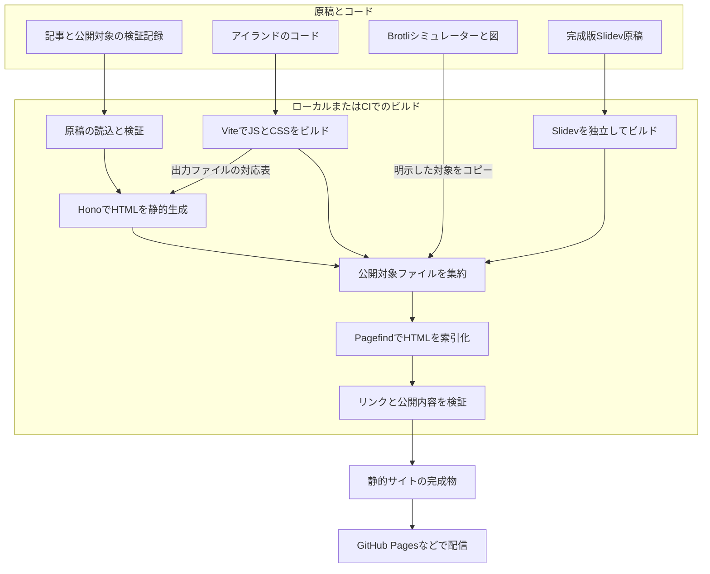
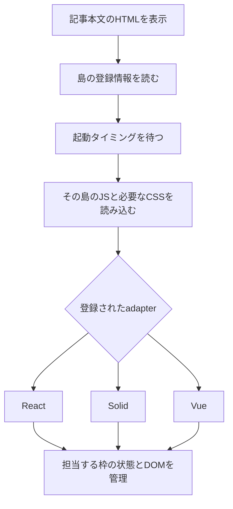

# Hono と Vite による学習用ブログの設計

作成日・更新日：2026-10-31。状態：段階0・1のローカル実装・確認を完了。段階2以降は未着手。

Howitworksを、学んだ仕組みを記事に残す場所に加え、ブログ自体の仕組みを実験する場所にする。HonoとViteで静的サイトを作り、必要な枠だけを動かすアイランド機構を自作する。その上でReact、React Compiler、Solid Signals、Vueの違いを比較する。

記事の原本、既存のBrotliシミュレーター、2026年10月30日に発表した完成版LTを継続利用する。現在動くAstro版は比較元として残し、新しい実装は別ディレクトリで進める。本書は実装手順を定める。ユーザーの依頼により段階0・1を `web/` に実装した。ソース移動や公開設定の変更は行っていない。[実装の読み方と起動方法](../web/README.md)・[確認記録](../web/verification/stages-0-1.md)

## 目次

- [設計方針](#設計方針)
- [引き継ぐ既存資産](#引き継ぐ既存資産)
- [全体構成とビルドの流れ](#全体構成とビルドの流れ)
- [ディレクトリ構成](#ディレクトリ構成)
- [原稿と公開ページの関係](#原稿と公開ページの関係)
- [自作アイランドの担当範囲](#自作アイランドの担当範囲)
- [React と Compiler の比較](#react-と-compiler-の比較)
- [検索と既存コンテンツの統合](#検索と既存コンテンツの統合)
- [段階的な実装手順](#段階的な実装手順)
- [移行完了の確認項目](#移行完了の確認項目)
- [後で決めること](#後で決めること)
- [公式資料](#公式資料)

## 設計方針

| 項目 | 方針 | 理由 |
| --- | --- | --- |
| 学習の対象 | HTML生成、JSの読み込み、ハイドレーション、状態更新、検索の索引化 | 自分の言葉で処理の流れを説明できるようにする |
| ページ生成 | Honoでルートを定義し、ビルド時にHTMLを生成 | HTTPの処理と静的生成の関係を学ぶ |
| ブラウザー向けビルド | Vite | JS・CSSの変換、分割、出力先とHTMLの接続を学ぶ |
| アイランド | 小さな読み込み処理と各ライブラリへの接続処理を自作 | どの枠をいつ起動するかを見えるようにする |
| 比較するUI | React、React＋Compiler、Solid、Vue | 同じ入力・操作・結果を、異なる更新方式で実装する |
| 原稿 | 既存のMarkdownを原本にする | サイト実装を変えても記事や出典を引き継げる |
| 検索 | Pagefind | 静的サイトだけで全文検索を提供する |
| 既存の体験教材 | BrotliシミュレーターとSlidevを独立して取り込む | 完成した教材を活かし、ブログ側の変更から分離する |
| 初期の配信方式 | 静的ファイルをGitHub Pagesへ置ける構成 | 公開先でHonoサーバーやDBを常時動かす必要をなくす |
| 実装中の比較元 | 現在の `site/` を残す | 記事、検索、教材の表示や操作を比べられる |

最初は通常のリンクでページを移動する構成にする。サイト全体をSPAにするルーターや、島同士の共通ストアは導入しない。実験ページごとに必要なライブラリを読み込み、記事を読むだけのページにReact・Solid・Vueをまとめて配らない。

HonoXの既存アイランド機構は、実装後に比較する参考とする。今回は接続部分を理解するため、Hono＋Viteから組み立てる。React CompilerはReactのコードを最適化するビルド時の処理であり、アイランドの分割・読込時期を担当するものではない。[React Compilerの役割](https://react.dev/learn/react-compiler/introduction)

## 引き継ぐ既存資産

2026-10-31に確認した手元のファイルを基準にする。

| 資産 | 現在の場所 | 新構成での扱い |
| --- | --- | --- |
| Brotli記事 | [articles/brotli-cve-2026-111497.md](../articles/brotli-cve-2026-111497.md) | 原本を移動・複製せず読む。現在の `status: draft` を維持する |
| 調査ノート | [notes/](../notes/) | 公開対象を明示した文書だけHTMLへ変換する |
| HTTP検証 | [experiments/brotli-http/](../experiments/brotli-http/) | コードとログを保持し、必要なものだけ閲覧用に取り込む |
| Brotli Visualizer | [simulators/brotli/](../simulators/brotli/) | `dist/` をそのまま配信する。React等への書き換えを前提にしない |
| 記事のパイプライン図 | [assets/brotli-pipeline/](../assets/brotli-pipeline/) | 独立した静的教材として取り込む |
| 完成版LT | [talks/brotli/slides.md](../talks/brotli/slides.md) | 本編7枚＋参考1枚を起点に、別ビルドで取り込む |
| LTアニメーション | [CompressionFlow.vue](../talks/brotli/components/CompressionFlow.vue)、[ParcelWorkbench.vue](../talks/brotli/components/ParcelWorkbench.vue) | Slidev内のVueコンポーネントとして継続利用する |
| 除外した実測スライド | [references/local-fetch-measurement.md](../talks/brotli/references/local-fetch-measurement.md) | 記録として保持し、LT本編には戻さない |
| 現在のブログ | [site/README.md](../site/README.md) | 記事、導線、検索、表示の比較元として残す |

`talks/brotli/rehearsal.md` は旧構成の台本であり、完成版の発表者ノートではない。完成版のノートは `slides.md` にある。`.draft-backups/` の旧デッキも移行元にしない。

発表日はユーザーから共有された2026-10-30を採用する。LTのREADMEには発表前の「発表日は未定」等が残っているため、公開用の紹介文を整える段階で文書間の表記を確認する。発表済みであることと、ブログ上で公開済みであることは別に扱う。

なお、シミュレーターの `simulators/brotli/dist/` は、現状ではビルド不要で動く実体である。名前だけを理由に削除可能な生成物として扱わない。

## 全体構成とビルドの流れ



ビルドを次の順序で組み立てる。

1. 原稿・教材の登録情報を読み、公開対象を確定する。下書きの除外は、ファイルのコピーや索引化より前に行う。
2. Viteで共通コードと必要な実験のJS・CSSを出力する。ReactのCompilerあり・なしは別の出力先にする。
3. Viteのmanifestを読み、HTMLから参照するJS・CSSのURLを解決する。ハイドレーションを扱う段階では、各ライブラリのサーバー描画用コードも別途ビルドする。
4. 原稿をHTMLへ変換し、Honoのルートを静的ファイルとして出力する。初期HTMLを作る島は、対応するライブラリのサーバー描画結果をページに組み込む。
5. 既存のシミュレーター・図・選択したログをコピーし、Slidevのビルドを合流させる。
6. 完成した検索対象HTMLをPagefindに渡し、検索データを同じ出力先へ追加する。
7. HTML・検索結果・教材へのリンク、下書きの混入、サブディレクトリ配信を確認する。

HonoのSSGは登録したルートの応答をファイルに保存する。URLと出力ファイルの対応は、既存の末尾 `/` 付きURLを直接開けるように調整する。[Hono SSG Helper](https://hono.dev/docs/helpers/ssg)

Viteのmanifestは、元のエントリーファイルと出力ファイル、CSS、依存チャンクの対応表である。ハッシュ付きファイル名をHTMLへ手書きせず、対応表から参照する。[Vite Backend Integration](https://vite.dev/guide/backend-integration)

公開先がGitHub Pagesの場合、Honoやサーバー描画用コードはビルド環境で実行する。読者に配信するのは完成したHTML、ブラウザー用JS・CSS、画像、検索データであり、記事を開くたびにHonoが起動する構成にはしない。

## ディレクトリ構成

既存資産はその場所に残す。新しい実装は `web/` に置き、現在の `site/` と並行して扱う。以下の `web/` 以下は完成時の計画を含む。段階1では原稿・ルート・レイアウト・CSS・設定・ビルド・配信・検証を作成済みで、島や検索のファイルはまだ作成していない。実際のファイルと役割は [webのREADME](../web/README.md#コードを読む順番) に記載する。

```text
Howitworks/
├── README.md
├── docs/
│   ├── hono-islands-design.md       この設計
│   ├── github-pages.md              現行Astro版の公開準備
│   └── deployment/                 未有効のWorkflowテンプレート
├── articles/                       記事の原本
├── notes/                          調査ノート
├── experiments/                    検証コードと実行ログ
├── simulators/brotli/               既存シミュレーター
├── assets/brotli-pipeline/          既存の動く図
├── talks/brotli/                    完成版LTと専用の依存関係
├── templates/                      記事と調査ノートのテンプレート
├── site/                           現在のAstro版
└── web/                            新しいHono版（以下は未実装の計画も含む）
    ├── README.md                   起動方法と現在できること
    ├── package.json
    ├── package-lock.json
    ├── config/
    │   ├── site.ts                 base、origin、下書きの扱い
    │   ├── resources.ts            教材と公開対象ファイルの登録
    │   ├── labs.ts                 実験ID、方式、公開状態の登録
    │   └── vite/                  shell、React、Solid、Vueの設定
    ├── src/
    │   ├── content/                原稿読込、schema、Markdown、リンク
    │   ├── server/                 Honoアプリ、ルート、描画処理
    │   ├── layouts/                共通枠と記事のHTML
    │   ├── client/                 検索UIなどのブラウザー用処理
    │   ├── islands/
    │   │   ├── core/               登録情報、読込時期、ライフサイクル
    │   │   └── adapters/           React、Solid、Vueへの接続処理
    │   ├── labs/
    │   │   ├── shared/             共通の入力データと操作シナリオ
    │   │   ├── react/              Compilerあり・なし共通のReact原稿
    │   │   ├── solid/              Signalsによる実装
    │   │   └── vue/                refによる実装
    │   └── styles/                 サイトと実験の表示
    ├── scripts/                    ビルド、集約、索引化、プレビュー
    ├── tests/                      公開範囲、生成、島の動作の検証
    ├── verification/               段階ごとの確認結果
    ├── .generated/                 ビルド途中の作業領域
    │   ├── client/                 方式別のJS・CSSとmanifest
    │   ├── server/                 方式別のサーバー描画用コード
    │   └── base-site/              サブディレクトリ配信の確認出力
    └── dist/                       通常の静的サイト完成物
```

最初から全ファイルを用意せず、実装する段階で必要なものを作る。`web/` の依存関係は独立して管理し、既存の `site/` と `talks/brotli/` のlockfileを変更しない。ルート全体をworkspaceへ再編することは初期作業に含めない。

React・Solid・Vueは、Viteのエントリーと変換設定を分ける。React CompilerをSolidのJSXやHono側のテンプレートへ適用しない。最初のページ枠は `hono/html` 等で生成し、島の描画は各adapterへ分ける。

各ビルドは専用の作業ディレクトリへ出力し、最後に集約する。後から実行するビルドの出力先初期化で、別の方式やSlidevの成果物が消えないようにする。サーバー描画用コードとmanifest自体は、配信物に必要なものを除いて公開ディレクトリへコピーしない。

## 原稿と公開ページの関係

記事は引き続き既存のfrontmatterを読み、Astro Content Collectionsに依存していた検証を `web/src/content/` へ移す。

| メタデータ | 役割 |
| --- | --- |
| `title`、`description`、`question` | 見出し、検索結果、中心となる問い |
| `topicId` | 関連する記事・ノート・教材を結ぶテーマID |
| `status` | `draft` または `published`。公開ビルドへの採否 |
| `createdAt`、`updatedAt` | 記事の作成日と更新日 |
| `verifiedAt`、`verificationScope` | 情報を確かめた日とその範囲 |
| `tags`、`aliases` | 分類と日本語名・英語名・別名による検索 |
| `simulator`、`talk` | 教材の登録IDへの参照 |

記事のURLは現在のファイル名に対応するIDを維持し、`topicId` の変更だけでURLを変更しない。ブログの実装を変えただけでは、記事の情報確認日を更新しない。

`resources.ts` は、教材IDとソースパス、配信先、関連する記事ID、取り込む文書・画像・ログを管理する。記事本文や公開状態を別の原本へ複製しない。現在の `simulator: brotli`、`talk: brotli` をそのまま解決できるようにする。

記事に従属する教材は、関連する記事が公開対象のときだけ取り込む。単独で作るフロントエンド実験は `labs.ts` に公開状態を持ち、初期値を下書きにする。公開対象でない記事・実験は、ページ、添付資料、索引のいずれにも出さない。調査ノート全体の自動公開は行わない。

URLは次を基本にする。実際の公開先に応じて、先頭へ `SITE_BASE` を付ける。

| パス | 内容 |
| --- | --- |
| `/`、`/articles/` | トップと記事一覧 |
| `/articles/<article-id>/` | 出典、目次、関連教材を持つ記事 |
| `/topics/`、`/topics/<tag-id>/` | 現在のタグ別一覧 |
| `/search/` | Pagefindによる検索と絞り込み |
| `/evidence/<id>/` | 選択した検証記録や操作説明 |
| `/labs/brotli/` | Brotliシミュレーターの説明と埋め込み |
| `/demos/brotli/`、`/demos/pipeline/` | 既存の静的教材本体 |
| `/talks/brotli/` | 完成版LTの紹介と記事へのリンク |
| `/decks/brotli/#/1` | 独立してビルドしたSlidev |
| `/labs/rendering/<experiment>/<variant>/` | React等を比較する新しい実験 |
| `/downloads/`、`/media/`、`/licenses/` | 公開対象のコード・ログ、画像、ライセンス |
| `/about/`、`/404.html` | プロジェクトの説明と存在しないページの案内 |

記事から「体験する」「LTを見る」「検証を読む」へ移動でき、各紹介ページから記事へ戻れるようにする。Markdownの相対リンク、見出しアンカー、画像、末尾スラッシュを現在のURL構造と照合する。対応のないローカルリンクは黙って残さず、ビルド時に報告する。

## 自作アイランドの担当範囲

アイランドは、静的な記事の中に置く、独立して動くUIの枠とする。自作するcoreはライブラリに依存しない登録情報と起動処理を持ち、DOM更新そのものはReact・Solid・Vueへ渡す。



登録情報には、島のID、コンポーネントID、renderer、初期データ、起動時期、初期HTMLの有無を持たせる。`react-compiler` はReactと別のrendererではなく、Reactコードのビルド方式を表すvariantにする。

| 処理 | coreの担当 | adapterの担当 |
| --- | --- | --- |
| 対象の識別 | 登録済みの島と出力manifestを対応付ける | 対応するコンポーネントを解決する |
| 初期値の受け渡し | JSON化できる値を埋め込み、HTML内で安全に読み戻す | 同じ初期値でUIを作る |
| 起動 | `load`、`visible` などの条件を判定する | 枠にUIを作る、または既存HTMLをhydrateする |
| 更新 | 島の外側は静的HTMLのまま保つ | 島の内側のDOMと状態を管理する |
| 終了 | 監視を外し、終了処理を呼ぶ | rootや購読を解除する |

最初に `load`、次に `visible` を実装する。`visible` はIntersectionObserverを使い、画面内に入ったときに起動する方式とする。同じ枠を二重起動しない。読み込みに失敗しても記事本文と案内は残し、失敗した島を識別できるようにする。

初期データは通常のJSONとして扱える小さな値に限定する。関数やDOM、秘密値を埋め込まず、`</script>` 等が本文として混入してもデータ境界を壊さない方法でエスケープする。コンポーネントは登録済みIDから解決し、原稿の任意の文字列をそのままimport先にしない。

Reactでは初期HTMLを持たない枠に `createRoot()` を使い、React自身が生成した初期HTMLを引き継ぐ枠には `hydrateRoot()` を使う。サーバー描画とブラウザー側で、コンポーネント、初期データ、IDのprefixを一致させる。[createRoot](https://react.dev/reference/react-dom/client/createRoot)、[hydrateRoot](https://react.dev/reference/react-dom/client/hydrateRoot)

Honoが生成する記事の枠と、Reactが管理するDOMの境界を分ける。HonoのJSXで生成した任意のHTMLを、そのままReactがhydrateできるとは扱わない。記事本文は島のJSがなくても読めるようにする。

島同士の状態共有は初期構成に入れない。ReactのContextを別root間で自動共有する設計にはせず、共有状態やAPIキャッシュは後の独立した実験にする。Brotliの既存iframeは、今回自作するアイランド機構とは別の統合方法である。

## React と Compiler の比較

最初の動作確認は同じカウンターで行う。Compilerの効果を観察する段階では、共通のダミー記事一覧、絞り込み・並べ替え、ヘルプ開閉を使う。「ヘルプを開くだけで、一覧の計算も実行されるか」を中心の問いにする。

| variant | 実装 | 確かめること |
| --- | --- | --- |
| `react` | CompilerなしのReact | 状態更新、コンポーネントの再実行、DOM反映の関係 |
| `react-compiler` | 同じReactソースにCompilerを適用 | どの計算や描画を再利用できるコードへ変換したか |
| `solid` | Solid Signals | 値の読み取りと依存関係、変更の通知 |
| `vue` | Vueのref | 依存追跡から表示の更新まで |

Reactの2種類は同じソース・Reactバージョン・初期値・操作手順を使い、Compiler設定と出力先を分ける。手書きの `useMemo` 等による最適化は最初の比較に混ぜず、必要なら別の比較条件として記録する。Compilerの導入方法は採用するViteプラグインのバージョンに合わせて選ぶ。[React Compiler Installation](https://react.dev/learn/react-compiler/installation#vite)

Compilerが有効という設定だけで効果を断定しない。対象が実際に変換されたことを出力やDevToolsで確認する。初回計算は必要であり、入力が変わった計算まで常に省略できるものではない。[React Compiler Introduction](https://react.dev/learn/react-compiler/introduction)

記録する観測は次のように分ける。

- どのJS・CSSを、いつ読み込んだか。
- 絞り込みや並べ替えの計算が実行されたか。
- コンポーネントやリアクティブな処理が実行されたか。
- 実際にどのDOMが変わったか。

再実行回数と処理時間、DOMの変更回数を同じ意味として扱わない。React StrictModeの開発時の追加実行は明記し、速度を測る場合は本番相当ビルドで条件をそろえる。観測用の副作用でCompilerの解析対象を変えてしまわないよう、生成コードや各ライブラリのDevToolsも使う。

React・Solid・Vueを同時に読み込む比較画面は後の拡張とし、最初は方式ごとにページを分ける。共通データと操作シナリオを共有し、JSX変換や状態更新の実装は共有しない。

## 検索と既存コンテンツの統合

### Pagefind

Pagefindは公開対象HTMLがそろった後に実行する。記事本文と教材紹介に `data-pagefind-body` を付け、ナビゲーションや操作ボタンを検索本文に混ぜない。日本語、別名、タグ、コンテンツ種類の絞り込みを引き継ぐ。[索引の生成](https://pagefind.app/docs/running-pagefind/)、[索引対象の指定](https://pagefind.app/docs/indexing/)

検索UIは初期段階では既存の挙動を参照した独立モジュールにする。React実験の成否によって記事検索まで動かなくなる結合を避ける。ブラウザーは生成済みの検索用JSと索引を読み、検索を行う。

検索対象は記事、選択した検証記録、シミュレーターと実験の説明、LTの紹介とする。SlidevのJS内部や操作後の表示をPagefindが実行して収集する前提にしない。将来ノートや動的UIの説明まで検索したくなったら、公開対象を決めて検索用HTMLへ明示的に変換する。

### Brotliシミュレーターと図

既存のシミュレーターとパイプライン図を専用の配信先へコピーする。紹介ページに操作対象の説明、出典への入口、記事へ戻るリンクを置き、iframeには内容を示すtitleを付ける。シミュレーター本体の挙動、配色、比較モデルは維持する。

Brotliの教材をReact比較用のサンプルへ転用するための書き換えは行わない。新しい実験は別ページとして作る。

### 完成版Slidev

現在の `talks/brotli/` にある依存関係、Geistテーマ、ローカルフォント、アニメーション、ノートを使ってビルドする。SlidevのVueと、ブログのVue実験は別のビルドとして扱う。[Slidevの静的ビルド](https://sli.dev/guide/hosting)

`--base` をサイトのbaseと配置先に合わせ、既存のハッシュルーティングを維持する。直接 `/decks/brotli/#/6` 等を開いて再読み込みできることを確認する。記事へ戻るリンクや、ノート内の検証記録リンクも新しい出力先で確かめる。

現在の統合ビルドには、Slidev内の特定の検証リンクを補正する処理がある。[現行ビルド](../site/scripts/build.mjs)を参照し、必要性を確認して引き継ぐ。完成版の原稿を旧構成へ戻して辻褄を合わせない。発表者ノートを配信物へ含める場合、ノートも閲覧可能なコンテンツとして扱う。

## 段階的な実装手順

すべて未着手。実装開始の依頼後、各段階の確認結果を `web/verification/` に残して進める。最初の4段階は島の仕組みを学ぶ最小構成とし、その後に比較対象とブログの機能を広げる。

| 段階 | 作るもの・作業 | 次へ進む条件 |
| --- | --- | --- |
| 0 現状を記録（完了） | 記事、教材、完成版LT、既存サイトの状態を確認。バージョンと比較用の操作を記録 | 原本141ファイルのハッシュと既存起動方法を記録。既存機能の再受け入れ試験とは区別する |
| 1 静的な記事（完了） | `web/` の最小構成、Honoのルート、原稿読込、Viteとのmanifest接続。既存記事1本をローカルで表示 | 初期HTMLに本文と出典がありscript要素0。 `/` と `/Howitworks/` の直接表示を確認。ブラウザーのJS設定変更は未実施 |
| 2 Reactの島 | 登録情報、`load`、React adapter、カウンター。続けて `visible` を追加 | 本文は静的に表示され、対象の島だけ起動する。画面外の島は設定したタイミングまで読み込まれず、二重起動しない |
| 3 ハイドレーション | Reactで初期HTMLを生成し、同じデータでhydrateする経路 | 初期値が一致し、mismatchがない。通常の起動とhydrateの違いを説明できる。複数の島でもIDが衝突しない |
| 4 React Compiler | 同一ソースをCompilerあり・なしでビルド。ダミー記事一覧とヘルプ開閉を比較 | 変換の有無、再計算、DOM変更を区別した記録がある。観測条件と結果を説明できる |
| 5 SolidとVue | 同じカウンター・記事一覧を各方式で実装し、adapterを追加 | 入力と表示結果がそろい、方式ごとのJSだけを読む。Signals・ref・Reactの更新経路を比較できる |
| 6 既存機能の統合 | 記事一覧、タグ、目次、コード表示、図、検証記録、Brotliシミュレーター、完成版LTを取り込む | 記事・教材・LTを往復できる。Brotliの3モードとLTの7枚＋参考1枚が現在の資産から動く |
| 7 検索 | Pagefindの索引化、検索UI、種類とタグの絞り込み | `Brotli`、`ブロートリ`、`node:http` 等で記事や紹介文へ到達できる。下書きが通常の検索へ混ざらない |
| 8 ローカル移行判定 | 現行Astro版と内容・リンク・表示を比較し、新構成の起動・確認手順を整える | 下記の移行確認項目を満たす。新旧の確認先と未解決事項が明確で、どちらでも原稿を読める |

段階3以降、SolidやVueで初期HTMLを再利用する場合も、それぞれのサーバー描画とhydrateの対応を確認する。React用の処理をそのまま流用しない。

段階1の `dev` はビルド後の静的配信で、変更時は再ビルドが必要。今後、記事やUIを素早く確認するモードと、全成果物・Pagefindまで生成するプレビューモードを分ける。検索索引は原稿の保存だけでは自動更新されないため、更新タイミングを明記する。HonoとViteを開発時につなぐ際は、HMRやReact Refresh用処理もVite公式の方法に合わせる。[Vite Backend Integration](https://vite.dev/guide/backend-integration)

段階8までの完了は、公開の実施やAstro版の削除を意味しない。既存の [GitHub Pages公開手順](github-pages.md) と [Workflowテンプレート](deployment/github-pages.yml.example) はAstro版向けのため、公開準備を依頼された段階で新しいビルド先・確認コマンドへ合わせる。

## 移行完了の確認項目

以下は実装後の確認項目であり、現在の検証結果ではない。

- [ ] 記事・ノート・実験ログ・教材・LTの原本が元の場所にあり、今回のサイト移行で内容を失っていない。
- [ ] 原稿のメタデータ検証、下書き除外、情報確認日、目次、コード表示、図と画像、相対リンクを引き継いでいる。
- [ ] 公開対象の教材・文書・ダウンロードを登録情報からたどれ、未登録のノートや旧デッキを配信していない。
- [ ] 通常ビルドではBrotli記事の `draft` と関連資料が除外され、明示したローカルプレビューでは確認できる。
- [ ] Pagefindの検索結果から正しいページとアンカーへ移動でき、検索対象を説明できる。
- [ ] 記事本文はJSなしで読める。島の読み込み失敗が本文の表示を壊さない。
- [ ] 起動時期、二重起動防止、初期値、hydrate、終了処理を確認している。
- [ ] ReactのCompilerなし・ありでソースと条件がそろい、コンパイル結果と実行時の観測を混同していない。
- [ ] スマートフォン幅、キーボード操作、フォーカス、動きを減らす設定で主要操作を確認している。
- [ ] BrotliのAPI比較、正常な入力待ち、修正前後の比較が動き、図や出典へ戻れる。
- [ ] 完成版LTの本編7枚＋参考1枚、4枚目・6枚目のアニメーション、発表者表示との同期を確認している。
- [ ] 外した実測スライドをLT本編に戻しておらず、旧台本を最新のノートとして案内していない。
- [ ] `/` と `/Howitworks/` で、リンク、検索、JS・CSS、iframe、Slidevの直接アクセスと再読み込みが通る。
- [ ] 全体ビルドを繰り返しても、別方式の出力や教材を消さず、古い下書き成果物が混入しない。
- [ ] 新旧サイトの起動手順と検証記録があり、公開準備として残る作業が分かる。

テストは内容の原本保護、公開範囲、URL生成、ライフサイクルなど、壊れると困る境界に絞る。見た目、実際の検索、Slidevの操作はブラウザーで確認し、ビルド成功だけで代用しない。

## 後で決めること

| 項目 | 決める時期 |
| --- | --- |
| React、Compiler、Solid、Vueのバージョン | 各段階の導入前に互換性と公式手順を確認し、lockfileへ固定する。Hono・Viteは段階1で固定済み |
| Markdown処理の拡張 | 段階1はMarked＋YAML＋Zod。Mermaid描画やコードの色分けは段階6で整える |
| 記事本文の途中に新しい島を置く記法 | 最初は実験ルートに定義し、記事内で必要になった段階で決める |
| 複数の島の状態共有、TanStack Query、API通信 | 初期構成と分け、調べたい問いができたときに実験を追加する |
| CMSとしてのEmDash | 編集画面やDB運用を学びたくなった時点で別テーマとして検討する |
| Cloudflare Workers上でのHono実行 | リクエスト時のSSRやAPIを試したくなった時点で検討する |
| 古いブログの記事移行と独自ドメイン | 新サイトの設計・実装とは別の移行計画として決める |
| `web/` を正式なサイトへ切り替える時期 | 段階8の確認後に決める。 `site/` の削除・改名は自動で行わない |

最初の実装単位である段階0と段階1は完了した。次は段階2のReactの島へ進む。段階6の教材・LT統合や段階7の検索を、今回の完了範囲には含めない。

## 公式資料

参照日：2026-10-31。具体的なAPIと設定形式は、実装時に採用するバージョンでも確認する。

| 資料 | この設計で確認したこと |
| --- | --- |
| [Hono SSG Helper](https://hono.dev/docs/helpers/ssg) | Honoのルートから静的ファイルを生成する仕組み |
| [Vite Backend Integration](https://vite.dev/guide/backend-integration) | manifestによるHTMLとアセットの接続、開発時の接続 |
| [React createRoot](https://react.dev/reference/react-dom/client/createRoot) | ページの一部だけをReactで動かす方法 |
| [React hydrateRoot](https://react.dev/reference/react-dom/client/hydrateRoot) | 初期HTMLとクライアント描画の一致、複数rootのID |
| [React Compiler Introduction](https://react.dev/learn/react-compiler/introduction) | ビルド時の自動メモ化と更新時の最適化 |
| [React Compiler Installation](https://react.dev/learn/react-compiler/installation) | Viteを含むビルドへの導入 |
| [Pagefind Running Pagefind](https://pagefind.app/docs/running-pagefind/) | 静的HTMLの後処理としての索引生成 |
| [Pagefind Configuring the Index](https://pagefind.app/docs/indexing/) | 検索対象と除外範囲の指定 |
| [Slidev Building and Hosting](https://sli.dev/guide/hosting) | 静的SPAへのビルド、base、ノートの扱い |

既存実装の参照先：[サイトのREADME](../site/README.md)、[原稿schema](../site/src/content.config.ts)、[公開対象とリンク対応](../site/scripts/config.mjs)、[素材の準備](../site/scripts/prepare.mjs)、[統合ビルド](../site/scripts/build.mjs)。
