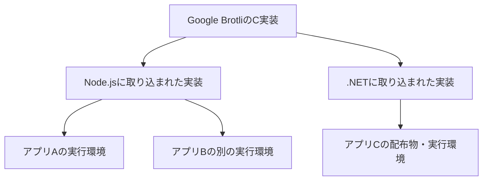

# 調査ノート：Brotliの1つの脆弱性が、なぜ複数製品・実行環境の更新につながるのか

- テーマID：brotli-cve-2026-111497
- 作成日：2026-10-27、最終更新日：2026-10-29（日本時間）
- 現在の段階：記事・5分LT資料を作成済み。記事にはWindows・WSLの本人の対応記録を一次情報と照合した体験談を追加。LTは10-28版のまま、練習は保留
- 記事：[Brotliを直接使わないコードにも脆弱性対応が必要になる理由](../articles/brotli-cve-2026-111497.md)（下書き）
- LT資料：[Slidev資料・発表者ノート](../talks/brotli/README.md)（本編12枚＋参考3枚。Vercelテーマ。発表日は未定）
- 情報の確認範囲：Macの実測は10-27、各社の対応告知は10-28時点。10-29は別のWindows開発機について本人が提示した対応記録を一次資料と照合した。対象PCでの再実行、起動中のアプリ・配布物の再検査は未実施

## 現在地

1. 今回の問い：Brotliの1つの脆弱性が、なぜNode.jsを含む複数製品・実行環境の更新につながるのか。
2. 現在の理解：共通のC実装が製品に取り込まれ、それぞれの配布物や実行環境に存在する。上流の修正を、利用している実体まで届ける必要がある。Macで選択されたNode.jsでは、Brotliの静的リンクを観測できた [E2]。
3. 確認できたこと：CVEと通称の対応 [S1]、上流の修正 [S2][S4]、各製品への取り込み [S5][S6][S7]、手元のNode.js 1個のリンク方式 [E2]、受信側に展開APIを書かなくてもfetch経由でBrotli応答が展開されること [E1]、Vercelの暫定保護と各社の更新告知 [S14〜S21]。E4の記録値と公式修正版の対応を確認し、.NET 9の判断と「完了」の範囲を訂正した。
4. まだ分からないこと：別の実行環境、HTTPS、HTTP/2、ブラウザーの挙動は今回の観測範囲外。CVEの発火・メモリ破壊・任意コード実行は再現していない。
5. 試したこと・結果：E2で静的リンクを確認し、ユーザーもgrepを使って同じシンボルを確認。E1では同じ103バイトの本文がfetch＋Content-Encoding: brのときだけ元の4,280バイトに戻った。性能測定と脆弱性の再現は未実施。
6. 次にやること：E4に残した.NET 9・Electron・残置イメージの確認事項を、本人の追加記録が得られた段階で更新する。新ブログは公開前確認の段階、公開は未実施。5分LTの練習は本人の再開依頼まで保留する。

## 壁打ち・調査範囲

### きっかけと理解済みの内容

「Node2Shell」「HTTP2Shell」への対応を複数の場所で求められるのはなぜか、という疑問を出発点にする。

ユーザーは、圧縮方式としてのBrotliと、その方式に従って圧縮・展開するライブラリとしてのBrotliの違いを理解済み。この区別の説明を繰り返すことより、実装の欠陥と依存関係を深掘りする。

### 今回扱うこと

- 展開処理のどこに欠陥があり、何が起き得るのか。
- 直接BrotliのAPIを書いていなくても、どの呼び出し経路で展開処理に到達し得るのか。
- ライブラリの同梱・組み込みと、製品・配布物・実行環境ごとの更新の関係。
- 上流の修正公開、製品への修正取り込み、稼働環境への反映を区別すること。

圧縮率のランキング、圧縮アルゴリズム全体の数学的解説、全製品の影響調査は別テーマとする。社内情報や社内環境は扱わない。初回の実験は自分で作る正常なデータによる動作観察とし、CVEの悪用再現は含めない。

区切りの目安は、複数製品への波及を図で説明でき、手元の動作観察と資料で確認した脆弱性の事実を区別して記事にできること。

## 主張と根拠の対応

| 確かめたい主張・問い | 現在の答え | 根拠の種類・出典 | 適用条件・限界 |
| --- | --- | --- | --- |
| Node2ShellとHTTP2Shellは別の脆弱性か | 今回の資料では、同じCVE-2026-111497に対する呼称 | JPCERT/CCの説明 [S1] | 通称よりCVE番号で照合する |
| 欠陥はどこか | Google BrotliのC実装のデコーダー。細工された圧縮データの展開時に境界外書き込みが起こり得る | 注意喚起・開発元情報 [S1][S2][S5] | Brotli形式に対応するすべての独立実装が同じ欠陥を持つとは断定しない |
| なぜ処理が続いてしまったのか | 不正なブロック切り替えを、追加入力が必要な状態として扱う経路があった | Node.jsの説明と上流の差分 [S5][S4] | このノートでは実行によるメモリ破壊を確認していない |
| なぜ各製品で対応するのか | 同じ上流実装が複数製品に取り込まれるため。Node.jsでは修正の取り込みが記録され、.NETでも更新方法が示されている | 公式情報からの整理 [S1][S6][S7] | 実際の配布・リンク方式と修正状況は製品ごとに確認する |
| HTTP/2を使わなければ関係ないか | 公式に説明された発火条件は、攻撃者が制御するBrotliデータを脆弱な実装で展開すること。HTTP/2限定という条件はない | 公式の影響条件からの整理 [S1][S5] | 通称から通信プロトコルの条件を追加しない |
| パッケージが存在すれば必ず攻撃可能か | 存在だけでは到達経路を確定できない。.NET公式も展開の設定・API利用条件を説明している | 開発元情報 [S7] | 含有、入力到達性、修正済みかを分けて確認する |
| Brotliの表示バージョンだけで修正済みと判定できるか | それだけに依存しない。Node.js 24.22.1は上流修正のcherry-pickを記載している。手元でもNode.js v24.22.1 / Brotli 1.2.0の表示を観測した | 開発元リリース情報 [S6]、実測 [E2] | 製品のリリース履歴と修正取り込みを確認する。今回バイナリの真正性やCVEの発火は検証していない |
| 自分で展開APIを書かなくてもBrotliが展開されるか | 手元のfetchはbrヘッダー付きの正常応答を自動展開した。node:httpとヘッダーなしのfetchでは圧縮されたまま | 同梱Undiciの実装 [S9]、実測 [E1] | Node.js v24.22.1のHTTP/1.1での正常データによる観測。攻撃や脆弱性の再現ではない |

### 脆弱性の仕組みについて、資料から分かったこと

Node.js公式は、不正なブロック切り替えが「入力待ち」と扱われ、ストリーミングデコーダーが8バイトの内部バッファへ入力を追加し続け得た、と説明している。結果としてプロセスのメモリ破損が起こり、異常終了、メモリ情報の漏えい、任意コード実行につながる可能性がある。[S5]

上流差分では、該当する処理が成功・追加入力待ち・形式エラーを区別して返し、その状態を呼び出し側へ伝えるよう変更されている。[S4]

ここで説明したのは公式の報告と差分の読解であり、自身が任意コード実行や実際の攻撃を観測したという意味ではない。

### 壁打ち用の説明：なぜ「展開」が脆弱性につながったのか

デコーダーは圧縮されたデータを読み、その形式のルールに沿って元のバイト列を復元する。通信でデータが少しずつ届く場合、読みたい情報の途中で入力が途切れることがある。この場合の「続きを待つ」は正常な動作。一方、形式のルールに反する入力には、続きを足しても正常にならず、その時点でエラーにすべきものがある。

今回、ブロック切り替えという内部の読み取り処理で、この2つの状態を区別できない経路があった。ブロック切り替えは、復号に使うブロックの種類・長さを切り替える処理であり、HTTP/2のフレーム切り替えのことではない。[S4]

1. 細工された圧縮データを、脆弱なデコーダーが読む。
2. 不正なブロック切り替えを、形式エラーとして止めず「入力不足」と扱ってしまう。
3. ストリーミング処理が、内部の8バイトのバッファへ入力を追加し続ける。
4. 確保された範囲を越えて書き込み、プロセスのメモリを壊し得る。[S5]

バッファとは、処理の途中でデータを一時的に置くメモリ領域。この8バイトは入力の一時保持用で、E1で観測した4,280バイトの展開結果を置く容量ではない。103バイトが4,280バイトに戻ること自体は正常な展開動作。

メモリが壊れると、アプリの異常終了、プロセスのメモリ情報の漏えい、任意コード実行につながる可能性がある。結果は条件によって異なる。境界外書き込みが起きれば必ずコード実行に成功する、という意味ではない。[S1][S5]

修正差分では、`DecodeBlockTypeAndLength`の戻り値が真偽値から状態を表すエラーコードに変更されている。不正な切り替えには`BROTLI_DECODER_ERROR_FORMAT_BLOCK_SWITCH`、入力不足には`BROTLI_DECODER_NEEDS_MORE_INPUT`、成功には`BROTLI_DECODER_SUCCESS`を返す。呼び出し側にも状態を伝え、成功以外では現在の処理を抜ける変更が加えられた。入力待ちで再開できる場合と、形式エラーで終了する場合を区別する修正と読める。[S4]

E1のfetchの経路と組み合わせると、自分で展開APIを書かなくても外部からの本文がデコーダーに届く場合がある、と理解できる。ただしE1で使ったNode.js v24.22.1は、公式にはこの修正の取り込みが記録された版。正常データを通したE1は、この経路の観測であって、修正前の不具合の再現ではない。[E1][S6][S9]

[記事用の動く図](../assets/brotli-pipeline/index.html)では、正常な展開・不正入力を受け取った修正前・修正後を切り替えられる。[図の出典・組み込み方・確認状況](../assets/brotli-pipeline/README.md)も保存した。

その後、操作しながら処理を追う[Brotli Lab](../simulators/brotli/README.md)をローカル実装した。API比較、正常な入力待ち、修正前後の分岐の3モードを備える。正常系の最終値はE1と対応し、途中のステップとバッファ表示は説明用のモデル。これを新しいCVEの実行検証とは扱わない。

### 複数の更新が必要になる構造

次の図は[S1][S5][S6][S7]をもとにした概念図。個別製品のすべてのビルド方式を示すものではない。

上流リポジトリの修正は、各環境にある古い配布物を自動的に書き換えない。更新の完了を説明するときは、次の段階を区別する。

1. 上流のBrotliで修正が公開された。
2. 利用製品が修正を取り込み、修正版を提供した。
3. 各アプリ・環境が、その製品の更新方法に従って修正済みの配布物へ切り替わった。
4. 実際に起動しているプロセスが、修正済みの実体を使っていることを確認した。

具体例として、.NET公式はself-containedアプリの再ビルド・再配布を案内している。またNativeAOTでは、マシンの共有ランタイムの更新だけで実行ファイル内のデコーダーは置き換わらないと説明している。[S7]

## 2026-10-28追記：Vercelと各社の対応告知

- 主張と確認範囲：VercelはHTTPクライアント経由のBrotli応答を展開前に拒否する暫定保護を公表。既存プロジェクトは再デプロイ [S14]。上流デコーダーの修正、ランタイム側の経路制限、受信側WAFを区別する。
- 比較：Azure App Service / Functionsの対象ランタイムの配布完了 [S15〜S17]、New RelicのPublic / PrivateとNode 16の例外 [S18]、Mendの内部コンポーネント更新 [S19]、Amazon Linuxの配布パッケージ [S20]、Cloudflare WAFの既定Log [S21]。詳細と出典は[記事の追記節](../articles/brotli-cve-2026-111497.md#vercelの暫定対策と各社が届ける更新)。
- 投稿由来の補足：ユーザーが共有したShohei Maeda氏のX投稿の引用には、10/26 18:10 UTC（10/27 03:10 JST）以降の適用、今週中の正式更新予定、node-fetchへの適用の記載がある。原ポストURLは未確認。これらの正確な時刻・期限・個別名は確認した公式Advisory本文にはなく、正式な保証・完了報告として引用しない。
- 未確認：各サービス上での実行検証は未実施。AWS Lambda・Netlify・Render・Railwayは今回の公開情報調査で同程度の適用範囲と完了状況を示す公式告知を確認できず、未対応とも判定しない。
- 考察：任意URL取得などで攻撃者のサーバーへ到達する構成なら、接続先の侵害や通信経路のハイジャックは必須とは限らない。S18の到達条件をもとに、通信先固定の構成と区別して整理した。
- 資料の新旧：Azureは検索結果に古い「展開中」の文面が残っていた。記事本文の更新欄と対象表で完了報告を確認した。ページ末尾の日付だけで更新状況を決めない。
- 次の確認：発表前にS14の正式更新完了と対象範囲を再確認。実測E1・E2と今回の文献調査を混同しない。

## 必須出典と補足出典

初期調査の参照日は2026-10-27。2026-10-28の記事化で再確認した資料と対象箇所は、[記事の出典一覧](../articles/brotli-cve-2026-111497.md)に記録する。10-29はS1・S2・S5・S6を再確認し、S22〜S30を追加した。.NETの照合はS7ではなく、同じ開発元の具体的な対象表を持つS26を使用。S14〜S21の告知状況は10-28時点のまま。主張には資料IDを対応させ、今後の更新時も対象バージョン・適用条件とともに再確認する。

| ID | 資料・発行元 | 確認した内容 | 公開・更新日または対象 |
| --- | --- | --- | --- |
| S1・ユーザー指定 | [JPCERT/CC 注意喚起 JPCERT-AT-2026-0034](https://www.jpcert.or.jp/at/2026/at260034.html) | CVE・通称・対象バージョン・複数製品への影響・開発元情報を確認する方針 | 2026-10-26 |
| S2・ユーザー指定 | [Google Brotli v1.2.1](https://github.com/google/brotli/releases/tag/v1.2.1) | CVE-2026-111497に対するセキュリティ修正リリース | v1.2.1。JPCERT/CCはGoogleの公開日を2026-10-21と記載 |
| S3・ユーザー指定 | [google/brotli](https://github.com/google/brotli)、[README](https://github.com/google/brotli/blob/master/README.md) | 公式実装の所在、仕様への参照、Pythonモジュールや独立実装への案内。形式への対応と同じ実装の利用を区別する手掛かり | masterのREADMEを参照。取得時のファイルSHA：f03387df4aadc8f798d8336e6c4f926e5378c2a8 |
| S4 | [Google Brotli修正コミット 0ed4268](https://github.com/google/brotli/commit/0ed4268a4401abcb4472096340477cf4af7d1a2b) | decode.c / decode.hでの形式エラーと追加入力待ちの区別、呼び出し側への伝播 | 差分を読解。実行検証は未実施 |
| S5 | [Node.js October 2026 Security Releases](https://nodejs.org/en/blog/vulnerability/october-2026-security-releases#nodejs-brotli-decoder-out-of-bounds-write-permits-remote-code-execution-cve-2026-111497---high) | 同梱デコーダーの問題、内部バッファへの書き込み、影響条件、修正リリースへの案内 | 2026-10-21 |
| S6 | [Node.js 24.22.1リリース](https://nodejs.org/en/blog/release/v24.22.1) | CVE修正として上流コミットをcherry-pickした記録 | 2026-10-21、24.22.1 |
| S7 | [Microsoft .NET公式アドバイザリー](https://github.com/dotnet/runtime/security/advisories/GHSA-p3jp-9v83-76w9) | 展開処理への到達条件、既定設定、self-contained / NativeAOTなど配布形態ごとの更新 | 2026-10-25公開。確認時点の内容 |
| S8 | [Node.js zlib公式ドキュメント](https://nodejs.org/api/zlib.html) | Brotliの圧縮・展開API。正常データを使った実験の実装時に参照する | 確認時点の表示はNode.js 26.12.1 |
| S9 | [Node.js v24.22.1同梱Undiciのfetch実装](https://github.com/nodejs/node/blob/v24.22.1/deps/undici/src/lib/web/fetch/index.js) | 応答のContent-Encodingに応じたBrotliデコーダー選択、Accept-Encodingの既定値 | v24.22.1固定タグ。ファイルSHA：2a63b5bd8aa2718952f49faf45252505aa96dc08 |
| S10 | [Node.jsのネイティブ展開処理](https://github.com/nodejs/node/blob/v24.22.1/src/node_zlib.cc#L1546) | BrotliDecoderDecompressStreamの呼び出し | 2026-10-28参照、v24.22.1固定タグ |
| S11 | [Node.js HTTP API](https://github.com/nodejs/node/blob/v24.22.1/doc/api/http.md#L30) | 低水準HTTP APIの役割 | 2026-10-28参照、v24.22.1固定タグ |
| S12 | [BrotliデコーダーAPI](https://github.com/google/brotli/blob/v1.2.1/c/include/brotli/decode.h#L230) | 入力待ち・出力待ち・成功・エラー、ストリーミングAPIの入出力 | 2026-10-28参照、v1.2.1固定タグ |
| S13 | [RFC 9110 HTTP Semantics](https://www.rfc-editor.org/rfc/rfc9110.html) | Content-Encoding、Content-Length、Accept-Encoding | 2026-10-28参照、2022年6月発行、§8.4・§8.6・§12.5.3 |
| S14 | Vercel Security Team [Node.js security advisory](https://vercel.com/kb/bulletin/node-js-security-advisory#vercel-managed-runtime-protection) | 掲載日2026-10-26、10-28に本文確認 | HTTPクライアントの暫定保護、再デプロイ、WAFとの範囲の違い |
| S15 | Microsoft / Byron Tardif [App Service Linuxの緊急更新](https://azure.github.io/AppService/2026/10/22/node-python-emergency-release-app-service-linux.html) | 2026-10-22公開、10-28時点の本文 | Standard・Latestへの配布完了、対象版、持ち込みランタイムの扱い |
| S16 | Microsoft / Byron Tardif [App Service Windowsの緊急更新](https://azure.github.io/AppService/2026/10/22/node-emergency-release-app-service-windows.html) | 2026-10-22公開、10-26追記 | 配布完了、実際のアプリプロセスの版の確認 |
| S17 | Microsoft / Byron Tardif [Azure Functionsの更新状況](https://azure.github.io/AppService/2026/10/23/time-zone-runtime-certificate-updates-azure-functions.html) | 2026-10-23公開、10-26追記 | OS・プランごとの対象表と完了報告、カスタムイメージの除外 |
| S18 | New Relic [Security Bulletin NR26-11](https://docs.newrelic.com/docs/security/new-relic-security/security-bulletins/security-bulletin-nr26-11/) | 2026-10-27公開 | Public / Privateの更新主体、Node 16の例外、外部応答の到達条件 |
| S19 | Mend.io [Mend for GitHub.com Release Notes](https://docs.mend.io/integrations/latest/mend-for-github-com-release-notes) | 26.9.3.3、2026-10-23 | 自社ホスト連携の内部コンポーネント更新とCVE修正の記載 |
| S20 | AWS [Amazon Linux CVE-2026-111497対応表](https://explore.alas.aws.amazon.com/CVE-2026-111497.html) | 10-28に確認、AL2023 nodejs24行の修正日10-24 | 当該パッケージのFixed表示。Lambdaの完了証拠ではない |
| S21 | Cloudflare [Emergency WAF Release](https://developers.cloudflare.com/changelog/post/2026-10-25-emergency-waf-release/) | 2026-10-25 | 関連ルールの既定動作がLogであること |
| S22 | Canonical / Ubuntu [CVE-2026-111497](https://ubuntu.com/security/CVE-2026-111497) | 24.04向け修正版1.1.0-2ubuntu0.1。公式nodejsパッケージのシステムBrotli利用に関する注記 | 10-28更新、10-29参照 |
| S23 | Git for Windows [v2.56.0.windows.4](https://github.com/git-for-windows/git/releases/tag/v2.56.0.windows.4) | 同梱Brotliを1.2.1に更新し当該CVEに対応 | 10-26公開、10-29参照 |
| S24 | Electron [v44.10.0](https://github.com/electron/electron/releases/tag/v44.10.0) | Chromium 152.0.7977.169、Node.js 24.22.1への更新 | 10-27公開（UTC）、10-29参照 |
| S25 | Electron [net API](https://www.electronjs.org/docs/latest/api/net#netfetchinput-init) | net.fetchはChromiumのネットワーク機能を使い、Node.jsのfetchと異なる。Brotliのリンク方式や個別製品の修正保証とは別 | 10-29参照 |
| S26 | Microsoft [.NET Security Advisory #494](https://github.com/dotnet/announcements/issues/494) | 影響する版、修正版8.0.33 / 9.0.22 / 10.0.14、既定設定、同梱配布物・NativeAOTの再配布 | 10-25公開・更新、10-29参照 |
| S27 | Docker [Building best practices](https://docs.docker.com/build/building/best-practices/#rebuild-your-images-often) | イメージと依存関係の更新、--pullと--no-cacheの違い | 10-29参照 |
| S28 | Node.js Project [Node.js Releases](https://nodejs.org/en/about/previous-releases) | Node.js 20・25がEOLであること。EOLは「影響なし」を意味しない | 10-29時点の対応表 |
| S29 | Bun [v1.4.4](https://bun.com/blog/bun-v1.4.4#security)・[同タグのBrotli依存指定](https://github.com/oven-sh/bun/blob/bun-v1.4.4/scripts/build/deps/brotli.ts) | Security節のBrotliの記載に加え、ソースがBrotli 1.2.1のコミットdb24a98を指定することを確認 | 10-22公開、10-29参照 |
| S30 | OpenAI / Patch the Planet [Brotli decoder vulnerability](https://patchtheplanet.org/brotli) | 発見者側の報告。Bun 1.4.4の修正、複数の同梱部品、HTTP以外の入力、再起動・配布物の確認 | ページ更新10-23、10-29にブラウザーで本文とOther software to checkを確認 |

記事のS3には[v1.2.1のREADME](https://github.com/google/brotli/blob/v1.2.1/README)を使用し、可逆圧縮と仕様への参照を2026-10-28に確認した。初期調査のmasterとは対象を分ける。

対象バージョンは製品ごとに読む。Brotliの修正版として[S1]は1.0.10 / 1.1.1 / 1.2.1を案内している。Node.jsの当該セキュリティリリースは22.23.4 / 24.22.1 / 26.12.1。[S5] これらは今回の修正を含むリリースの記録であり、将来も常に最新であるという意味ではない。

## 検証計画と実施記録

E2のリンク方式確認とE1の正常HTTP応答の観察を実施済み。ユーザー自身のE1追試でも同じ結果を確認した。使用した実行環境、ランタイムの版、入力、手順、実施日を各記録に残す。

### [E1] HTTP応答のどこで展開されるかを観察する（ローカル実行済み）

- 目的：自分で展開APIを書かなくても、上位APIの処理中に展開が起こるかを確かめる。
- 入力：自分で作った小さなテキストを正常にBrotli圧縮したデータ。
- 手順：127.0.0.1だけで待ち受けるHTTP/1.1サーバーから同じ圧縮済み本文を返す。node:http＋brヘッダー、fetch＋brヘッダー、fetch＋応答ヘッダーなしの3ケースを比較した。要求のAccept-Encodingは全ケースでbrに統一した。
- 実行前の予想：低水準APIでは圧縮された本文、`fetch()`では展開済み本文を受け取る。
- 観測：送信したHTTP本文はすべて103バイト。fetch＋brヘッダーだけ4,280バイトとなり、元の本文と完全一致した。他2ケースは圧縮済みデータと完全一致。終了コード0、サーバー自動停止を確認。
- 詳細：[HTTP自動展開の検証記録](brotli-http-auto-decode-2026-10-27.md)。再現コード、実行ログ、コマンドと出力の読み方を保存。
- 限界：正常データの処理経路を観察する実験。成功してもCVEの再現や修正完了を証明しない。APIのバージョン別挙動は実装時にも確認する。

### [E2] 実行環境と、取り込まれた修正を対応させる（1環境のリンク方式確認済み）

- 目的：ライブラリ、ランタイム、実行中の実体を区別する。
- 手順：検証用Node.jsのバージョン・Brotliの表示バージョン・実行ファイルを確認し、ビルド設定、`otool -L`、`nm -m`を照合した。Node.js公式の修正履歴も確認した。
- 実行前の予想：実行環境は独立した実体として確認する必要があり、ひとつの環境の更新記録だけでは別環境の状態を説明できない。
- 実測：nvm配下のNode.js v24.22.1、macOS arm64。`node_shared_brotli=false`、動的リンク先にBrotliなし、実行ファイルのコード領域にBrotli展開関数の定義あり。Brotliを静的リンクしていると判断する。
- 詳細：[MacのNode.jsリンク方式の検証記録](brotli-node-linkage-2026-10-27.md)。コマンド、出力、意味、対象範囲を記録。
- 限界：Brotliの表示バージョンだけで安全・危険を判定しない。修正を個別に取り込む場合があるため、製品の履歴を確認する。[S6]

### [E3] 修正差分から、入力待ちと形式エラーの違いを読む（資料確認済み）

- 目的：破損した入力を「続きを待てばよい」と扱うことの問題を理解する。
- 方法：公式差分[S4]で戻り値と呼び出し側の扱いを追う。
- 観察：`DecodeBlockTypeAndLength`の戻り値がエラーコードを表す型になり、形式エラーと追加入力待ちを分ける変更を確認した。呼び出し側でも状態を受け取って処理を抜ける変更がある。
- LTへの案：正常な入力途中と不正な入力を並べた状態遷移図にする。
- 限界：差分の読解のみ。メモリ破壊や任意コード実行の再現結果として扱わない。

### [E4] Windows・WSLの対応記録と一次情報の照合（2026-10-29）

#### 資料の由来と確認範囲

- 入力資料：本人が提示した非公開の個人資料「Brotli 脆弱性 解析から対応までの記録」。10-28の棚卸しと10-29の対処をまとめたもの。本人のChrome上で本文・比較表・詳細の折りたたみを開いて確認した。
- 環境：Windows 11開発機とWSL Ubuntu 24.04。E1・E2のMacとは別環境。
- 根拠の区別：コマンド結果や作業の実施は本人の記録による報告。公式資料は修正版・適用条件の根拠。この記事化ではWindowsのコマンド、生ログ、実行ファイル、プロセス、イメージを再検査していない。
- 公開範囲：導入元・一般的な製品名・必要な版情報・判断の経緯を要約。非公開資料のURL、社内のリポジトリ名・パス・個別の構成情報は転載しない。

#### 記録上の作業と、照合して言えること

| 対象 | 本人の記録 | 一次資料との照合・記事での扱い |
| --- | --- | --- |
| Windows Node.js | 使用中24.21.0から24.22.1へ。node -vで確認。25.2.1を削除、旧24.x・22.xは一部残置 | 24.22.1の修正取り込みはS6と一致。選択中の版の更新であり、全版の撤去・全プロセスの切り替えとはしない。25はEOL [S28] |
| pnpm | Node切り替え後にコマンドが使えず再導入 | 作業上の付随事項として扱う。pnpmの版だけでBrotliの修正状況を説明しない。導入方式や使われるランタイムを特定せず一律に対象外とも扱わない |
| WSL Node.js | nvm管理の24.13.0から24.22.1へ。nvm currentとdefaultを確認。24.13.0は残置 | S6と整合。S22のUbuntu公式nodejsパッケージの説明をnvm配下の別配布物へ転用しない |
| WSL libbrotli1 | 1.1.0-2build2から1.1.0-2ubuntu0.1へ。curlの表示はbrotli/1.1.0 | S22で24.04の修正版と確認。上流の表示とディストリビューションのパッケージ版を区別。稼働中プロセスの読み込み直しは未検証 |
| Git for Windows | 2.56.0(4)へ更新。Git同梱curlの-Vがbrotli/1.2.1。確認当時のwinget提示版は(3) | S23にCVEとBrotli更新の明記あり。wingetの状態は当時の観測。Windows標準curlと混同しない |
| VS Code / Obsidian | アプリ更新後の実行ファイル内の文字列からNode 24.21.0 / 24.22.0を記録 | 実行中プロセスの確認とは別。S24はElectron自身がNode 24.22.1へ更新した証拠で、各アプリが採用済みかは未確認。アプリ全体の修正完了とはしない |
| Claude Code / Bun | バイナリ内のBun 1.4.4の文字列から対応済みと判断 | Bun 1.4.4がBrotli 1.2.1を含むことはS29・S30で補強できた。個別アプリの実行中ランタイム確認は別の証拠が必要 |
| Docker Desktop | 更新後、Rancher Desktopへ一本化する判断。詳細にはアンインストールを実施した旨も記載 | 見出しは「決定」、比較表・詳細は「実施」で粒度が混在。今回のPCで削除完了を再確認していないため、記事はこの項目を完了数の根拠にしない。CLIの自動切り替えを一般化しない |
| ローカルイメージ | Nodeの版を確認して不要分を削除。24.12.0を含む開発用イメージ2個は次回再ビルドとして残置 | 整理済みと修正済みを分け、残置分は未完了。ローカル専用という理由だけでは入力到達性を否定できない。--no-cacheだけではベースイメージ更新にならない [S27] |
| .NET | 8.0.33 / 9.0.21 / 10.0.14を記録。9.0.22を通常更新扱い | S26では9.0.21は影響範囲、修正版は9.0.22。記事で訂正。8.0.33 / 10.0.14は修正版と一致するが、各アプリがそれを選ぶかや同梱配布物の状態は別途確認が必要 |
| CI等の版固定 | 手元とは別の設定にNode 20固定が残る旨を記録 | 20のEOLをS28で確認。ローカルNodeの更新はCIや公開環境の修正完了を意味しない。固有名や設定本数は本文に持ち込まない |

#### 断定を採用しなかった箇所

1. **「Chromium 148以上で主要経路は閉じる」**：今回読んだElectron公式資料は通信経路の違いとリリースの更新内容を確認する根拠にはなるが、そのしきい値や全製品への適用を保証しない。Chromiumの該当修正の取り込み、各アプリの実際のビルドと呼び出し経路の照合が残る。
2. **「ElectronにはBrotliが必ず2本ある／Node側もChromiumのBrotliを使う」**：S25から確定できるのはネットワークAPIの違いまで。S30も複数のコピーが含まれ得ると述べ、ChromiumとNode.jsの両方の確認を求める。個別バイナリのリンク構成やパッチ適用を調べず、どちらも一般論として採用しない。44.10.0を全Electron系列の一律の修正版下限にもしない。
3. **「既定で展開しない.NETは通常更新でよい」**：S26は影響を受ける版と、攻撃者入力を展開する到達条件を別々に説明している。未修正ランタイムの存在を否定する根拠にはならない。.NET 6も告知表にないという理由で安全とは判定しない。
4. **「PHP・nginx・DBの公式イメージなどは一律に対象外」**：タグ・ベースOS・導入パッケージ・拡張機能を特定しない一般化は採用しない。Python・Rust・Windows標準curlについても、この端末で調べた対象と経路の範囲に限る。今回の生ログ未確認のため、製品全体の対象外一覧として転載しない。
5. **「Claude CodeはBun 1.4.4の文字列があるから修正完了」**：Bun 1.4.4自体の修正根拠はS29の固定タグの依存指定とS30の修正版表で確認できた。一方、文字列の検出だけでは、個別アプリが実際に使用するランタイムと修正反映の証明まではできない。部品側の修正と実行中の実体の確認を分ける。
6. **「9件完了・6件待ち・8件対象外」**：アプリ更新済みと同梱部分の確認待ちが重なり、残置イメージや削除を報告したアプリも含まれる。件数を排他的な完了集計として転記せず、対象ごとの状態を残す。

#### 記事に残す結論と未完了事項

Node.js・OSパッケージ・同梱curlを、それぞれの配布元と実体に沿って調べた経緯を本文に採用する。入力到達性、修正版の提供、手元の適用状態を分け、一次情報で判断が変わった.NETの例も残す。

残るのは、.NET 9の使用状況と修正、個別Electron製品の告知・ビルド・実際の経路、残置Nodeとイメージを利用する前の更新、起動中プロセスへの反映確認。これらの更新・削除・再起動を今回の編集作業で実行したわけではない。

## 記事化・LT化のメモ

- 仮タイトル：「Brotliの脆弱性、なぜこんなに更新箇所があるのか？」
- 中心の答え：同じ実装が複数の製品と実行環境に取り込まれているため、上流の修正を各実体まで届ける必要がある。影響は、脆弱な実装を含むことと、外部からのデータが展開処理へ到達することを分けて考える。
- 想定する聞き手：Web開発に関わる人。圧縮方式と実装の区別は短い前提説明にする。
- 持ち時間：5分。説明・デモ4分40秒＋予備20秒。本編12枚。2026-10-29版では対応体験65秒、Vercelの暫定対策25秒、デモ35秒。補足は質疑用3枚と発表者ノートへ。
- 持ち帰ってほしいこと：「共通部品がどこに入り、どこで入力を処理し、修正がどの実体まで届いたか」をたどる視点。
- 話の流れ：複数箇所の更新への疑問 → 公式注意喚起 → 同梱・組み込みの図 → 正常データでの動作観察 → エラー処理の修正 → 修正を各環境へ届ける話。
- 理解の確認：なぜOSのライブラリ更新だけでは足りない場合があるか。Brotliを圧縮する側と展開する側のどちらが今回の条件か。上流修正版の公開と手元の修正完了の違いを説明できるか。

ユーザー自身の理解がどう変わったかは、これからの壁打ち・検証後に記録する。現時点で理解済み・発表可能と判定しない。

## 派生した別の問い

- 静的リンク、動的リンク、ソースコードの同梱、ランタイムへの組み込みはそれぞれ何が違うか。
- ソフトウェア部品表や依存関係のスキャンは、組み込みライブラリをどこまで把握できるか。
- ストリーミング処理で、入力待ち・入力終了・形式エラーをどう設計するか。

## 更新履歴

- 2026-10-27：初期調査と検証計画を作成。ユーザー指定の3資料を確認し、方式と実装の区別は理解済みとして調査の焦点を設定。
- 2026-10-27：E2を実施。Macで選択されるNode.js 1個のBrotli静的リンクを確認し、検証記録へリンク。
- 2026-10-27：ユーザーのE2追試結果を記録。E1を実施し、正常なBrotli HTTP応答がfetch内部で展開されることを3ケースで比較した。
- 2026-10-27：ユーザーのE1追試が同じ結果で完了。入力待ちと形式エラーの混同から境界外書き込みに至る説明を追記し、記事用の動く図を作成。
- 2026-10-27：1ステップ操作、入力待ちでの停止、修正前後の同期比較を備えたBrotli Labをローカル実装。起動手順、出典、実測とモデルの区別を記録。
- 2026-10-28：記事の下書きを作成。E1・E2の記録と公式資料を照合し、シミュレーターの操作順、入力待ちと形式エラー、内部の8バイトバッファと展開後サイズの違いを整理。S10〜S13を追加。

- 2026-10-28：各社の対応調査を記事へ反映し、S14〜S21を追加。LT本編11ページにVercelの暫定対策を追加し、表示バージョンの例を参考へ移動。説明・デモ4分40秒＋予備20秒に再配分。
- 2026-10-29：本人のWindows・WSL対応記録をE4として照合し、記事に体験談を追記。S22〜S30を追加。.NET 9.0.21の扱い、Electronの一律判定、残置イメージの完了扱いを見直した。非公開の固有情報は転載せず、LTの更新・公開・実環境の修正は実施していない。
