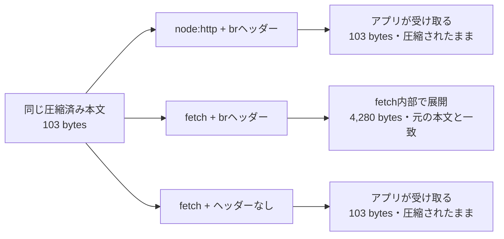

# 検証記録 E1：Brotli展開APIを書かずにHTTP応答が展開されるか

- テーマID：brotli-cve-2026-111497
- 元の調査ノート：[Brotliの脆弱性と複数環境の更新](brotli-cve-2026-111497.md)
- 実施日：2026-10-27（日本時間）
- 現在地：エージェントの実行と、ユーザー自身の追試で同じ3ケースの結果・PASS・サーバー停止を確認済み
- 環境：Node.js v24.22.1、darwin/arm64、Brotli表示バージョン1.2.0、組み込みUndici 7.30.1
- 通信：127.0.0.1上のHTTP/1.1のみ。外部サーバーへのアクセスなし
- 依存追加・設定変更：なし。Node.jsの組み込み機能だけを使用

## 問いと実行前の予想

受信側にBrotli展開APIの呼び出しがなくても、HTTPクライアントが応答の本文を自動展開するか。

低水準の `node:http` では圧縮済みの本文を受け取り、`fetch()` では `Content-Encoding: br` に応じて元の本文を受け取ると予想した。さらに、同じ圧縮データでもこのヘッダーを付けなければ、`fetch()` も展開しないと予想した。

## 実験の構成

| ケース | 受信API | 応答のContent-Encoding | サーバーが送るHTTP本文 |
| --- | --- | --- | --- |
| A | `node:http` | `br` | 正常なBrotli圧縮データ |
| B | `fetch()` | `br` | Aと同じバイト列 |
| C | `fetch()` | なし | Aと同じバイト列 |

3ケースともリクエストに `Accept-Encoding: br` を明示する。応答は同じ `Content-Type: application/octet-stream`、同じContent-Length、同じ圧縮済みBufferを使う。Cは圧縮済みファイルのバイト列をそのまま返す比較用の応答で、HTTPのContent-Encodingとしては指定しない。

元データは、次の自作の1行を40回繰り返したUTF-8テキスト。Brotliのqualityは4に固定する。

```text
Brotliを直接呼ばなくても、HTTPクライアントが本文を展開することがあります。
```

## ファイルと再現コマンド

- [run.mjs](../experiments/brotli-http/run.mjs)：送信用データの圧縮、サーバー起動、3ケースの実行、結果比較、自動停止。
- [client.mjs](../experiments/brotli-http/client.mjs)：受信側の処理。Brotliの展開APIを呼び出さない。
- [実行ログ](../experiments/brotli-http/result-2026-10-27.txt)：今回の標準出力を保存。

プロジェクトのルートディレクトリで実行する。

```sh
node experiments/brotli-http/run.mjs
```

`node` はJavaScriptを実行するランタイム、後ろは実行するファイルのパス。`.mjs` は `import` を使えるES module形式のファイル。パッケージのインストールは不要。

実行すると、空いているポートでローカルサーバーを起動し、3回のHTTP通信、結果の表示と一致確認を行い、最後にサーバーを停止する。ポート番号は実行ごとに変わってよい。

初回は実行環境のサンドボックスにより `listen EPERM` となった。同じスクリプトをローカル待ち受けに必要な実行権限で再実行したところ、終了コード0で完了した。環境の制限で失敗した実行は、Brotliの動作結果として扱わない。

## 観測結果

元の本文は4,280バイト、圧縮後は103バイトだった。サーバー側でも、3回すべてHTTP/1.1、要求のAccept-Encodingは `br`、送信した本文は103バイトであることを確認した。

ユーザー自身の追試でも同じ結果が得られた。起動ポート番号は異なるが、本文のサイズとバイト列の一致、HTTPバージョン、ヘッダーの条件は一致した。保存済みの実行ログはエージェント実行時のもので、追試の確認根拠はユーザーがチャットへ貼り付けた出力。

| ケース | encoding | contentLength | bodyBytes | sameAsOriginal | sameAsCompressed |
| --- | --- | --- | --- | --- | --- |
| A：node:http | br | 103 | 103 | false | true |
| B：fetch | br | 103 | 4280 | true | false |
| C：fetch、応答ヘッダーなし | (none) | 103 | 103 | false | true |

- `encoding`：受信APIから見えるContent-Encodingヘッダー。
- `contentLength`：受信APIから見えるContent-Lengthヘッダーの値。
- `bodyBytes`：アプリのコードが受け取った本文のバイト数。
- `sameAsOriginal`：受け取った本文が、圧縮前の本文とバイト単位で完全一致するか。
- `sameAsCompressed`：受け取った本文が、圧縮済みのデータとバイト単位で完全一致するか。

最後に以下を確認した。途中の一致確認に失敗した場合、PASSは表示せず終了コード1になる。

```text
PASS: A and C preserve compressed bytes; B returns the original bytes.
Local server stopped.
```

このバイト数はHTTP本文の比較であり、HTTPヘッダーやTCP/IPなどを含む総通信量の測定ではない。圧縮率・速度の一般的なベンチマークとしても扱わない。

## どの処理が展開したのか

受信側の `client.mjs` は、`fetch()` で応答を取得し、`response.arrayBuffer()` で本文を読み出す。`Buffer.from(...)` はそのバイト列をNode.jsのBufferとして扱うための変換で、Brotliの展開処理ではない。

```js
const response = await fetch(url, {
  headers: { 'Accept-Encoding': 'br' },
});
const body = Buffer.from(await response.arrayBuffer());
```

上は受信処理の要点。実ファイルにはタイムアウト、ヘッダー取得などもあるが、Brotli展開APIの呼び出しはない。送信側の `run.mjs` だけが、実験用データを作るためにBrotli圧縮APIを使う。



観測結果は、Node.js v24.22.1に同梱されたUndiciの実装とも対応している。実装では応答の `content-encoding` を読み、`br` の場合に `zlib.createBrotliDecompress` を選んでいる。[公式ソースの該当箇所](https://github.com/nodejs/node/blob/v24.22.1/deps/undici/src/lib/web/fetch/index.js#L2256)

記事用に[動くパイプライン図](../assets/brotli-pipeline/index.html)と[図の出典・使い方](../assets/brotli-pipeline/README.md)を用意した。正常な展開と、資料に基づく修正前・修正後のエラー処理を切り替えられる。

## 2つのヘッダーの役割

| ヘッダー | 向き | この実験での意味 |
| --- | --- | --- |
| `Accept-Encoding: br` | クライアント → サーバー | Brotliを使った応答を受け取れる、と伝える |
| `Content-Encoding: br` | サーバー → クライアント | この応答の本文にはBrotliの符号化が適用されている、と伝える |

Accept-Encodingを書くだけで、低水準の `node:http` に自動展開機能が付くわけではない。今回Aも同じ要求ヘッダーを送ったが、圧縮済みの本文を受け取った。

Node.js v24.22.1の組み込みfetchは、Accept-Encodingを明示しない場合、HTTP URLには `gzip, deflate`、HTTPS URLには `br, gzip, deflate` を設定する。そのため今回のHTTPローカル実験では、比較条件をそろえてBrotli応答を要求するために `br` を明示した。要求での広告と、応答を受け取った際の展開は区別する。[同梱Undiciのヘッダー設定](https://github.com/nodejs/node/blob/v24.22.1/deps/undici/src/lib/web/fetch/index.js#L1523)

## Content-Lengthが103のまま、本文が4,280になる理由

今回のfetchでは、アプリに見える応答ヘッダーは圧縮時のContent-EncodingとContent-Lengthを保持していた。一方、読み出した本文は展開済みだった。

したがって `Content-Length: 103` と、アプリで測った `body.length === 4280` は矛盾しない。前者はこの応答で送った圧縮済み本文の長さ、後者は受信APIがアプリに渡した展開済み本文の長さ。これは確認したNode.js・Undiciの挙動であり、すべてのHTTPクライアントが同じようにヘッダーを公開するとは断定しない。

## 分かったことと限界

今回の条件では、自分の受信コードにBrotli展開APIがなくても、`fetch()` の内部処理でBrotliデータが展開され、元の本文が渡された。サーバーが別の本文を送った可能性は、同じBufferを全ケースで送る実装と、低水準APIでのバイト列の一致確認により切り分けた。

この実験は、自分で作った正常データによるHTTPクライアントの処理経路の観察。CVEの発火、メモリ破壊、任意コード実行、修正の有効性は検証していない。HTTPS、HTTP/2、ブラウザー、別のHTTPクライアント、受信リクエストの自動展開は今回の対象外。

前回のE2で確認した「Node.jsにBrotliが静的リンクされている」と、今回の「上位APIからその展開機能が使われる」をつなぐと、自分でBrotliを直接操作していなくてもランタイムの修正が関係する理由を説明できる。

## 出典

すべて2026-10-27参照。

- [Node.js v24.22.1同梱Undiciのfetch実装](https://github.com/nodejs/node/blob/v24.22.1/deps/undici/src/lib/web/fetch/index.js)：Content-Encodingに応じたデコーダー選択、Accept-Encodingの既定値。取得時ファイルSHA：2a63b5bd8aa2718952f49faf45252505aa96dc08。
- [Node.jsのfetchドキュメント](https://nodejs.org/api/globals.html#fetch)：組み込みfetch API。公開ページの表示は確認時点でv26.12.1。実験対象のv24.22.1の内部挙動は上記の固定タグのソースで確認。
- [Node.jsのHTTPドキュメント](https://nodejs.org/api/http.html)：低水準HTTP API。
- [Node.jsのzlibドキュメント](https://nodejs.org/api/zlib.html#zlibbrotlicompresssyncbuffer-options)：送信用データを圧縮するAPI。
- 観測の根拠：[再現コード](../experiments/brotli-http/run.mjs)、[受信側コード](../experiments/brotli-http/client.mjs)、[実行ログ](../experiments/brotli-http/result-2026-10-27.txt)。
