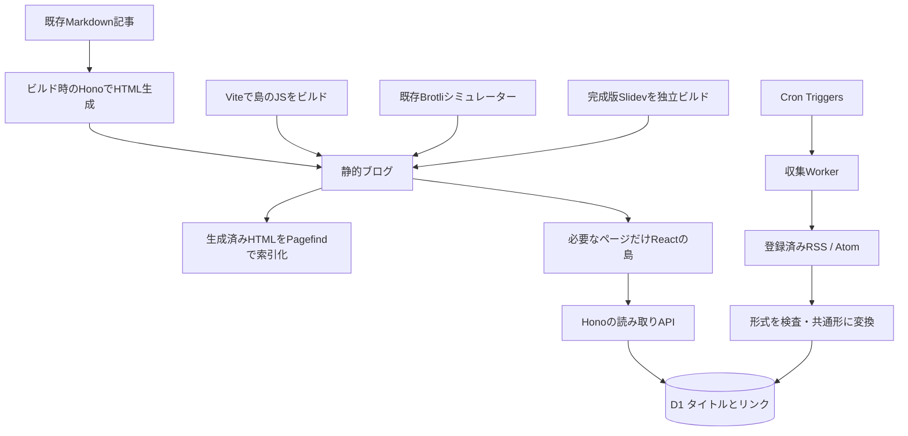

# 「気になる最新情報」の構成案と判断事項

2026-10-31。実験結果を受けた設計案。採用・実装・公開の決定ではない。

## 全体の流れ



左側は記事をビルドする仕組み。右側は公開後も定期的に情報を集める仕組み。**記事のビルドとRSS収集を別の仕事にすると、収集失敗でブログ全体を止めずに済む。** 今回、分けた構成の主要部分はローカルで確認できた。

Pagefindは静的HTMLを読み、記事の索引を作る。後からAPIで取得した新着一覧は自動では入らない。今回は検索結果が静的記事1件・動的一覧0件となることをブラウザで確認した。

## 公開先の選択肢

| 案 | 成立する構成 | 利点 | 引き受けること |
| --- | --- | --- | --- |
| GitHub Pagesを維持 | 静的ブログ + Cloudflareの収集Worker/D1/API | 今の公開準備を活かす。フロント実験と収集を分離できる | 別originのAPI、CORS、API停止時の表示 |
| Cloudflareへまとめる | Workers Static Assets + Hono API + D1 | 同じoriginで記事とAPIを配信できる | 公開先変更、既存Pages手順との整合、課金・キャッシュ設計を別途検証 |
| 一覧も静的にする | 収集結果のスナップショットをビルドへ渡す | JSがなくても一覧を読める。ビルド時なら検索索引にも入れられる | 新着反映に再ビルドが必要。CIへ渡す仕組みと認証が増える |

現在の検証からは、1案目を続ける技術的な障害は見つかっていない。2案目も有力だが、今回そのクラウド構成を動かしたわけではない。選択はユーザーに返す。

## 収集するもの・保存するもの

初期版で表示するのはタイトルとリンク。補助情報は情報源、公開日または更新日、初回発見日。本文・要約・全文再掲載は含めない。

| 概念 | フィールド案 | 意味 |
| --- | --- | --- |
| 購読元 | `source_id`, `feed_url`, `name`, `enabled` | コード管理する登録済み情報源 |
| 項目の識別 | `source_id + external_id` | RSSのguid、Atomのid。欠ける場合はURL |
| 表示 | `title`, `url` | HTMLとして挿入せず、テキストと検査済みリンクとして扱う |
| 提供された日時 | `published_at`, `updated_at` | 日付が欠けたらnull。更新日を公開日と言い換えない |
| 取得側の日時 | `first_seen_at`, `last_seen_at` | 自分のシステムが見つけた時刻 |
| 取得状態 | `etag`, `last_modified`, `last_checked_at`, `last_success_at`, `last_error` | 未更新と取得失敗を区別する |
| 掲載の扱い | `visibility`または購読元単位の掲載設定 | 全件自動掲載か、自分で選ぶかを決めてから詳細化 |

検証用D1は最小フィールドだけを持つ。上表をそのまま製品スキーマとして作成したわけではない。

同じ情報を再取得しても増殖しないことは確認済み。異なる情報源が同じ記事を紹介する場合の横断的な重複排除、同時に走った取得処理の新旧逆転、URLやguidが後から変わる場合は未検証。初期実装前に扱いを決める。

## 取得処理の設計

1. 登録済みURLを取り出す。任意URLを公開APIから渡せる仕様にはしない。
2. 前回のETagがあれば`If-None-Match`、なければ提供されたLast-Modifiedを使う。
3. `304`なら一覧は保持し、確認時刻だけ更新する。`200`なら上限を設けて読む。
4. RSS/Atomの形式を確認し、タイトル・URL・ID・日付へ正規化する。
5. 1情報源の更新をトランザクションとして保存する。
6. 失敗した情報源の直前の成功データは残し、失敗として記録する。

本番前には、タイムアウト、レスポンスの展開後バイト数上限、項目数上限、リダイレクト先、Content-Type、429のRetry-After、再試行間隔を確定する。検証では容量上限と不正XML・503・304を確認したが、これらすべてを実装したわけではない。

実験上の4MiB上限ではWorkers RSS約2.9MBを処理でき、Cloudflare全体RSS約8.8MBを拒否した。これは**4MiBを採用するという意味ではない**。製品別フィードへ絞るか、上限を上げるか、ストリーム解析へ進むかの比較材料。上限に達したときは「新着なし」ではなく取得失敗として扱う。

最初の取得では古い投稿も入る。「新着」を公開日で判定するか、初回発見日で判定するか、初回に何件掲載するかを決める必要がある。RSSは全履歴の保証されたアーカイブではない。

## 読み取りAPIとアイランド

API案は`GET /api/updates?limit=30&cursor=...`。保存済み一覧を返し、閲覧リクエストのたびにRSSを取りに行かない。公開APIの項目には秘密情報を含めない。取得上限とページ送りを設け、`lastSuccessAt`などで更新状況を伝える。

CORSは「別originのブラウザJSに読み取りを許可する設定」。認証・アクセス制御の代わりにはならない。今回のCORS確認はHTTPヘッダー検査までで、別originからの実ブラウザ通信は未検証。

Reactの島は、読み込み中・取得失敗・前の一覧・再取得ボタンを扱う。TanStack Queryは将来、複数画面の共有キャッシュや再取得方針を比較する際の候補とする。タイトル一覧1か所の成立条件にはしない。

自作アイランドの残りの設計対象は、どのページへどのJSを載せるか、`load`/`visible`等の起動条件、propsの安全な直列化、アンマウントと画面遷移、エラーの閉じ込め。今回の試験は**静的HTML内の指定枠へクライアントでmountする最小形**。SSRしたReactのhydrate、遅延起動、複数ライブラリを同一ページへ載せた相互動作までは確認していない。

React・Solid・Vueで共通にするのは、HTML上の枠と受け渡すデータの約束。状態管理やDOM所有権まで共通化する必要はない。まず1種類で入口を確かめ、その後ページ別の比較実験へ広げると違いを観察しやすい。

## Cloudflareの役割

| 役割 | 今回の位置付け |
| --- | --- |
| Cron Triggers | 時間になったら収集を起動する。AWS EventBridge Schedulerの「定期起動」に近い役割。EventBridge全体と同一ではない |
| Workers | RSS取得・変換・API応答のコードを実行する |
| D1 | タイトルとリンク、取得履歴をSQLで持つ |
| Queues | 情報源ごとに処理を分ける、失敗を再処理する段階で候補。SQSに近い役割 |
| Workflows | 本文取得→変換→要約など複数段階を再開可能にしたい時の候補 |
| R2 / AI | 本文保存・AI要約へ進む場合に追加検討。今回の初期機能では不要 |

CronはUTCで動く。Queuesは重複配信を考慮する必要があるため、後から追加する場合も今回検証した重複防止を維持する。[Cron公式](https://developers.cloudflare.com/workers/configuration/cron-triggers/)、[Queues配信保証](https://developers.cloudflare.com/queues/reference/delivery-guarantees/)。

## 3日クールダウンの運用案

```text
更新候補を調べる
  → stable / 公開から72時間経過 / 非deprecatedを確認
  → 依存の要求範囲・Node engines・peerDependenciesを確認
  → lockfile生成
  → 間接依存も公開時刻とintegrityを検査
  → 既知脆弱性と変更内容を確認
  → 隔離テスト・ブラウザ検証
  → トレードオフがあればユーザー判断
  → 採用後に本体へ反映（今回はここへ進まない）
```

「stable」は今回の直接依存候補の選び方。stableの製品がbetaの内部依存を持つ事例は実際にあった。間接依存のprereleaseも一律禁止するかは別の方針として判断する。

`min-release-age=3`だけでは、既にlockfileに固定された若い版の復元まで拒否できない。lockfile全体の時刻検査も必要。72時間経過や`npm audit`の検出0件は安全性の証明ではない。緊急のセキュリティ修正が待機中の場合の例外は自動で発動せず、根拠を示してユーザーに返す。[npm設定](https://docs.npmjs.com/cli/v11/using-npm/config/#min-release-age)。

検証フォルダ内だけ3日を設定した。Macユーザー設定の7日、既存ブログの依存、既存CIは変更していない。

## 判断後の段階案

1. **ローカルMVP**：公開先・掲載方針・購読元を決め、収集1本→保存→API→Reactを実際のブログへ接続する。
2. **運用の検証**：条件付き取得、複数情報源、日時、初回取り込み、同時実行、失敗表示・ログを確認する。
3. **公開準備**：確定した公開先でbase、キャッシュ、CORS、設定、監視、料金、鍵の管理を確認する。認証と外部変更は別途許可のある段階で実施する。
4. **実験場として拡張**：React Compiler比較、Solid/Vueのページ別アイランド、本文Markdownの取得・読む画面へ進む。

既存の記事・シミュレーター・完成版LTは内容を作り直さず、既存の生成物とルートを接続する。今回それらの再ビルドはしていない。
