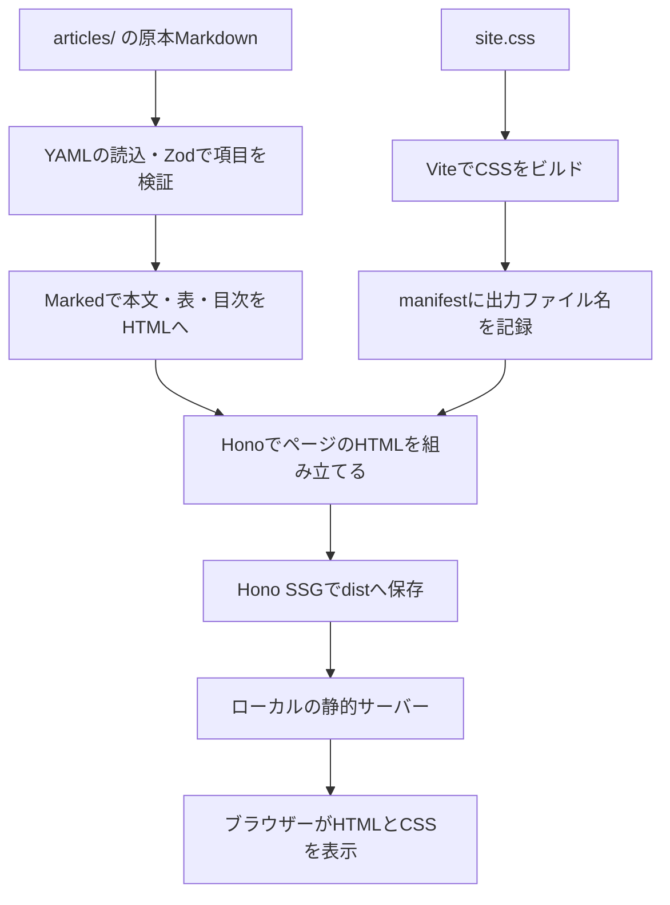

# Hono＋Viteで記事を静的生成する

2026-10-31、[設計書](../docs/hono-islands-design.md)の段階0・1を実装しました。既存のAstro版は `../site/` に残っています。

ここでは **原稿を読む → HTMLにする → 保存する → ブラウザーへ届ける** ところを、自分で接続しています。Reactなどのアイランドは次の段階です。

## 開く

Node.js 26.13.0以上を使います。プロジェクトルートから実行します。

```sh
# 初回だけ。web/package-lock.jsonに固定した依存関係を復元する
npm --prefix web ci --ignore-scripts

# 下書きも含めてビルドし、このPCだけで閲覧できるサーバーを起動する
npm --prefix web run dev
```

- 一覧：<http://127.0.0.1:4331/>
- Brotli記事：<http://127.0.0.1:4331/articles/brotli-cve-2026-111497/>
- 停止：起動したターミナルで `Ctrl+C`

`--prefix web` は、`web/package.json` のコマンドを使う指定です。`dev` は初回ビルド後に静的ファイルを配信します。**まだHMRはありません。** 原稿やCSSを変えたら停止して再実行し、ブラウザーを再読み込みします。起動中に別のターミナルでビルドだけをやり直すこともできます。

`dev` はそのプロセス内で `INCLUDE_DRAFTS=1` を設定します。記事の `status: draft` や、PC全体の環境設定は変更しません。

## 何が動いているのか



Honoは今回、**ビルド中にページの応答を作る役**です。`hono/ssg` が各ルートへ内部的にリクエストし、応答をHTMLファイルとして保存します。閲覧のたびにHonoが動くSSRではありません。

Viteは今回、CSSを変換してファイル名にハッシュを付けます。Honoはファイル名を決め打ちせず、Viteのmanifestから読みます。次の段階では、この接続に島のJavaScriptも追加します。[Hono SSG Helper](https://hono.dev/docs/helpers/ssg)・[Vite Backend Integration](https://vite.dev/guide/backend-integration)

記事ページにはブラウザー用のJavaScriptを出力していません。本文・目次・表・出典はHTMLに含まれ、JavaScriptの実行を待たずに読めます。リンク先の既存シミュレーターは別ページでJavaScriptを使います。

## コードを読む順番

| ファイル | 担当 |
| --- | --- |
| [scripts/build.ts](scripts/build.ts) | 全体の順序。原稿、Vite、manifest、Hono、素材コピーを接続 |
| [src/content/article.ts](src/content/article.ts) | 原本の読込、frontmatter検証、下書きの表示判定 |
| [src/content/markdown.ts](src/content/markdown.ts) | 本文の変換、目次、相対リンクの置き換え |
| [src/server/app.ts](src/server/app.ts) | `/`、記事、参照資料、404のHonoルート |
| [src/layouts/page.ts](src/layouts/page.ts) | HTMLの枠、記事見出し、メタデータ、目次 |
| [src/styles/site.css](src/styles/site.css) | 画面の見た目とレスポンシブ表示 |
| [config/site.ts](config/site.ts) | URLのbase、出力先、下書きプレビュー設定 |
| [config/resources.ts](config/resources.ts) | 今の記事から参照する素材だけを明示的に登録 |
| [scripts/serve.ts](scripts/serve.ts) | 完成したファイルを127.0.0.1へ配信 |

TypeScriptはNode.js 26の型消去で直接実行します。実行とは別に `tsc --noEmit` で型を検査します。Vite設定はこの段階では `scripts/build.ts` 内に置いています。

## ビルドと確認

```sh
# 通常の生成。現在のBrotli記事はdraftなので、記事と関連素材を含めない
npm --prefix web run build
npm --prefix web run check

# 下書きを含むローカル確認用の生成
INCLUDE_DRAFTS=1 npm --prefix web run build
npm --prefix web run check
npm --prefix web run preview
```

`build` はファイルを作るだけで、公開操作はしません。`check` は型検査、6件のテスト、生成物のリンク・アンカー・下書き除外・原本ハッシュを確認します。先に対象のビルドを済ませてください。`preview` は再ビルドせず、直前に生成したファイルを配信します。

ルート版の出力は `web/dist/` です。`build` はこの出力を毎回作り直すため、手で編集しません。`site/dist/` や元の記事・LTには書き込みません。

GitHub Pagesのプロジェクトサイトのようなサブパスも、ローカルで確かめられます。

```sh
SITE_BASE=/Howitworks/ INCLUDE_DRAFTS=1 npm --prefix web run build
SITE_BASE=/Howitworks/ npm --prefix web run check
SITE_BASE=/Howitworks/ PORT=4332 npm --prefix web run preview
```

確認先は <http://127.0.0.1:4332/Howitworks/articles/brotli-cve-2026-111497/> です。`SITE_BASE` を指定した生成物は `web/.generated/base-site/` に保存し、ルート版の `dist/` と分けます。これらの環境変数は、そのコマンドだけに適用されます。

## 今回の範囲と次の段階

- 記事本文・表・コード・目次・出典リンクを表示します。既存の白／ネイビー／青を基調にしています。
- 記事から参照される調査ノートやコードは、原文をエスケープした「参照資料」のページで読めます。ノート内のMarkdownリンクを再帰的にサイト化する処理はまだありません。
- 記事内の既存画像と、リンク先のシミュレーター4ファイルを変更せずコピーします。これは記事のリンクを保つ最小限の処理です。教材紹介ページやLTの統合は段階6です。
- Mermaidのコードブロックは記法のまま表示します。図としての描画、コードの色分け、タグ別一覧、Pagefind、Slidevのビルドは今後です。
- React・React Compiler・Solid・Vueのアイランドは未実装です。次は段階2のReactカウンターと起動タイミングを扱います。

`noindex` や `draft` はアクセス制限ではありません。ローカル確認用の生成物を公開すれば、その中身は閲覧できます。また、公開リポジトリに原稿を置けば、サイトへの掲載状態にかかわらず原稿を読めます。

確認結果と残る範囲は [段階0・1の記録](verification/stages-0-1.md) を参照してください。
